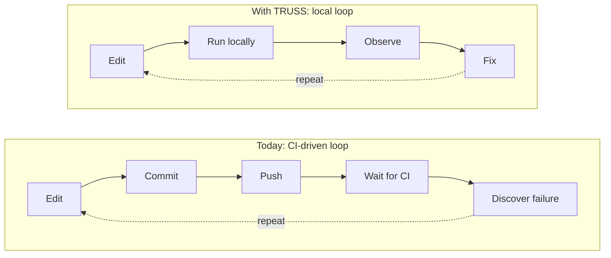
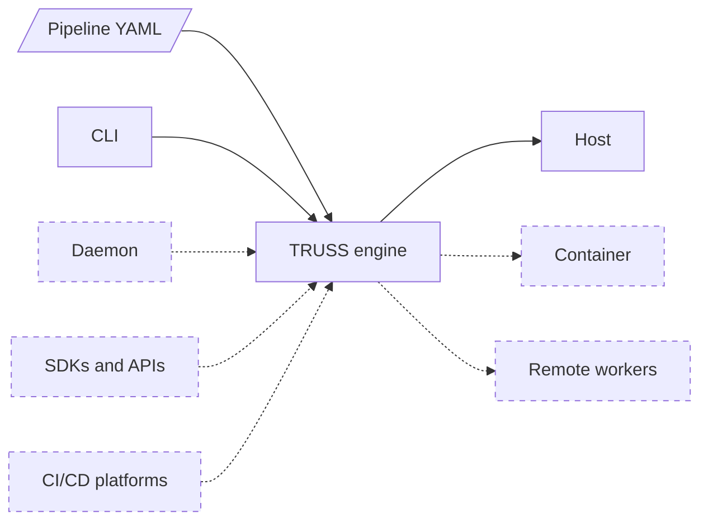
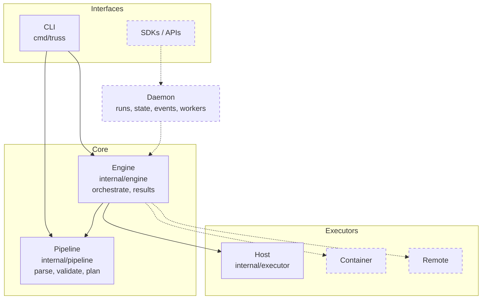
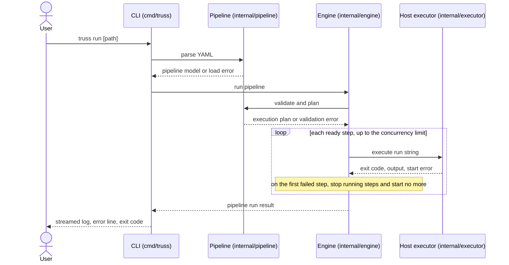
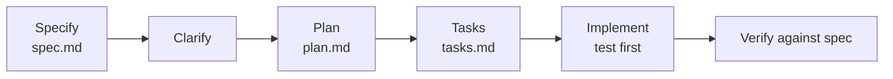

# TRUSS

**A portable pipeline execution platform. Define a pipeline once in YAML and run it the same way on your machine, in CI, and anywhere else.**

[](https://github.com/afri-bit/truss/actions/workflows/ci.yml)
[](go.mod)
[](LICENSE)

> **Status:** early development. The first release is [v0.1.0](docs/MILESTONE.md). It is not tagged yet. The pipeline schema and CLI output may still change until that milestone is complete.

## Contents

- [Why TRUSS](#why-truss)
- [Vision](#vision)
- [Features](#features)
- [Getting started](#getting-started)
- [Usage](#usage)
- [Pipeline definition](#pipeline-definition)
- [Architecture](#architecture)
- [Tech stack](#tech-stack)
- [Roadmap](#roadmap)
- [Development](#development)
- [License](#license)

## Why TRUSS

Pipelines are software, but they are rarely developed like software.

- **Slow feedback.** You commit and push, then wait in a CI queue just to find out whether a single command works.
- **Locked to one platform.** A pipeline written for GitHub Actions, GitLab CI, Jenkins, or Azure Pipelines only runs there. Moving platforms means rewriting it.
- **Hard to debug.** Failures happen on a remote runner you can't step into, with an environment you can't easily reproduce.
- **Implicit behavior.** It is often unclear what runs, in what order, with which environment, and why it failed.

TRUSS treats a pipeline as an executable artifact rather than platform configuration. The same definition runs locally while you work on it and unchanged wherever it is deployed.



## Vision

TRUSS aims to be a lightweight execution layer for software pipelines. The place a pipeline runs may change; its definition and execution semantics should not.



<sub>Solid: available today. Dashed: planned.</sub>

### Design principles

- **Local first.** If a pipeline can run on a developer machine, it should. Remote CI is not required to find out whether a pipeline works.
- **Portable.** The pipeline model does not depend on any CI provider, container runtime, or orchestrator. Those integrate with TRUSS; they do not define its semantics.
- **Engine first.** Parsing, validation, planning, execution, and results form the core. The CLI, daemon, SDKs, and dashboards build on top of it.
- **Explicit over magic.** You can tell what will run, in what order, with what environment, what each step produced, and why something failed.
- **Small, but clean.** The scope starts deliberately small, with clear boundaries, strong contracts, and tests from day one.

## Features

Available today:

- YAML pipeline definitions (schema version `"1"`), with optional `needs` between steps.
- Validation before execution. An invalid definition never starts a command.
- Host execution through `/bin/sh -c` on Unix and `cmd /c` on Windows. Steps run one at a time unless `pipeline.concurrency` is raised.
- Each step runs in the invoker's working directory with the invoker's environment.
- A local run log, shown live and saved to `.truss/run.log`.
- Fail-fast behavior. The first failed step stops the run, stops the steps still running, and reports its real exit code.
- Linux, macOS, and Windows support.

## Getting started

### Install

With Go 1.27.3 or newer:

```bash
go install github.com/afri-bit/truss/cmd/truss@latest
```

Prebuilt binaries for Linux, macOS, and Windows (amd64 and arm64) will be published on [GitHub Releases](https://github.com/afri-bit/truss/releases) starting with the first tagged version.

### Build from source

```bash
git clone https://github.com/afri-bit/truss.git
cd truss
go build -o bin/truss ./cmd/truss
```

### Your first pipeline

Create `truss.yaml`:

```yaml
version: "1"

pipeline:
  name: hello-world

steps:
  - id: hello
    run: echo "Hello from TRUSS"
  - id: where
    run: echo "running in $PWD"
```

Run it:

```console
$ truss run
2026-11-01 10:00:00 setup environment ready
...
2026-11-01 10:00:00 step hello started
2026-11-01 10:00:00 step hello | Hello from TRUSS
2026-11-01 10:00:00 step hello finished duration 0.002s exit 0
...
2026-11-01 10:00:00 summary succeeded steps 2 duration 0.004s
```

The full log is described under [Output](#output).

## Usage

```text
truss run [<path>]
truss help
truss version
```

| Command | Behavior |
|---|---|
| `truss run` | Loads `truss.yaml` from the current directory. It does not search for other filenames. |
| `truss run <path>` | Loads the given file. Any filename is valid. |
| `truss help`, `truss --help`, or `truss` with no command | Prints usage and exits 0. Starts no step and writes no run log. |
| `truss version`, `truss --version` | Prints the version and exits 0. Starts no step and writes no run log. |
| anything else | Prints usage and exits 1 without running anything. |

### Output

`truss run` prints one run log. Every line starts with the local time, `YYYY-MM-DD HH:MM:SS`. The same text is saved to `.truss/run.log` in the working directory when the run finishes, so you can open it later. The next finished run replaces it. A run that is rejected before it starts does not change it.

A run starts with a setup section. It shows that the environment is ready, the operating system, the architecture, the host shell, and the working directory. It never lists environment variable names, values, or secrets.

This is the log of a run where the second step fails (paths and timestamps trimmed):

```console
$ truss run truss.yaml
2026-11-01 10:00:00 setup environment ready
2026-11-01 10:00:00 setup os linux
2026-11-01 10:00:00 setup arch amd64
2026-11-01 10:00:00 setup shell /bin/sh
2026-11-01 10:00:00 setup directory /home/me/project
2026-11-01 10:00:00 step first started
2026-11-01 10:00:00 step first | one
2026-11-01 10:00:00 step first finished duration 0.002s exit 0
2026-11-01 10:00:00 step second started
2026-11-01 10:00:00 step second | two
2026-11-01 10:00:00 step second finished duration 0.001s exit 3
2026-11-01 10:00:00 summary failed steps 2 duration 0.003s
2026-11-01 10:00:00 error demo failed at second (exit 3)
```

The lines TRUSS writes:

| Line | Meaning |
|---|---|
| `setup ...` | The setup section, described above. |
| `step <id> started` | The step began. |
| `step <id> \| <text>` | One line the step wrote. The label always names the step. |
| `step <id> stopped because step <other> failed` | The step was stopped because another step failed. It appears only when steps run together. |
| `step <id> finished duration <s>s exit <code>` | The step ended with that exit code. |
| `step <id> finished duration <s>s error <diagnostic>` | The step could not start, or it ended by a signal. It has no exit code. TRUSS never prints `-1`. |
| `summary <status> steps <n> duration <s>s` | The result is `succeeded` or `failed`. `<n>` counts the steps that started. |
| `error <pipeline> failed at <step> (exit <code>)` | The run failed. It names the first failure TRUSS observed. |

When steps run together (see [`pipeline.concurrency`](#pipeline-definition)), lines from different steps may alternate. Every line still has its step's label, and each step's own lines stay in the order that step wrote them. Started steps are listed in the order they started.

If a step fails while other steps are running, TRUSS stops those steps right away. Each stopped step shows its output so far, then the `stopped` line, then its finish line. Steps that had not started do not appear in the log.

Ctrl-C on any host, or SIGTERM on Linux and macOS, interrupts the run. TRUSS ends all running steps and their processes, prints `error: context canceled` to standard error, and exits 1. An interrupted run saves no log, and the existing `.truss/run.log` stays as it was.

An invalid definition is rejected before any step runs:

```console
$ truss run broken.yaml
error: missing or unsupported schema version
```

### Exit codes

| Outcome | `truss` exit code |
|---|---|
| The run succeeded and `.truss/run.log` was saved | `0` |
| `truss help`, `truss version`, or bare `truss` | `0` |
| A step failed, the definition was rejected (file missing, unreadable, invalid YAML, failed validation, unknown field, invalid `concurrency`), the log location is unusable, usage was wrong, or the run was interrupted | `1` |

The `truss` exit code is not the step's exit code. The step's exit code appears in the log.

### Steps and the terminal

- A step cannot rely on terminal input. Do not run commands that ask for a password. On Linux and macOS, a step that reads from the terminal is stopped by the terminal and waits until you interrupt `truss`.
- When a step's shell exits, TRUSS ends any process that step started and left running. A later step cannot depend on it.
- A step that is stopped gets no chance to clean up. Do not rely on a command reaching its last line.
- On Windows, a stopped step exits with code `21586`, so a step that failed on its own is never mistaken for a stopped one.

## Pipeline definition

```yaml
version: "1"            # required, quoted string; only "1" is supported

pipeline:
  name: build-and-test  # required, non-empty
  concurrency: 2        # optional, whole number of at least 1; default 1

steps:                  # required, at least one step
  - id: build           # required, unique within the pipeline
    run: go build ./... # required, one command string for the host shell
  - id: lint
    run: golangci-lint run ./...
  - id: test
    needs: [build]      # optional, step ids that must succeed first
    run: go test ./...
```

| Field | Rules |
|---|---|
| `version` | Must be the string `"1"`. A bare number such as `1` is rejected. |
| `pipeline.name` | Required and non-empty. |
| `pipeline.concurrency` | Optional. A whole number of at least 1. Default 1. The most steps that may run at the same time. |
| `steps` | A list with at least one step. |
| `steps[].id` | Required, non-empty, and unique. |
| `steps[].run` | Required and non-empty. The host shell interprets it, including quotes, pipes, and variable expansion. |
| `steps[].needs` | Optional list of step ids. The step starts only after each listed step has succeeded. |

Any other field is an error. TRUSS does not ignore it. A typo such as `concurency` or `need` stops the run before any step starts.

Every step starts a new shell, so `cd` or `export` in one step does not carry over to the next. The full contract for the first version lives in [`specs/001-host-pipeline-engine/contracts/pipeline-v1.md`](specs/001-host-pipeline-engine/contracts/pipeline-v1.md). The dependency and concurrency rules are in [`specs/003-step-dependencies/`](specs/003-step-dependencies/) and [`specs/004-step-concurrency/contracts/pipeline-v1.md`](specs/004-step-concurrency/contracts/pipeline-v1.md).

### Recognised fields

| Where | Fields |
|---|---|
| Top level | `version`, `pipeline`, `steps` |
| `pipeline` | `name`, `concurrency` |
| Each step | `id`, `run`, `needs` |

Unknown fields are rejected. The error names the field and where it appears:

```console
$ truss run truss.yaml
error: unknown field "concurency" in pipeline
```

The other messages follow the same form: `unknown field "<name>" at top level`, and `unknown field "<name>" in step "<id>"` (or `in step <N>` when the step has no id).

### Steps start in order

Steps start in the order they are written, subject to two rules:

- A step with `needs` starts only after every step it lists has succeeded. A step with no `needs` does not wait for the step written above it. `needs` is the only dependency.
- At most `pipeline.concurrency` steps run at the same time. When more steps are ready than the limit allows, the ones written earliest start first. A freed slot goes to the next ready step.

With the default limit of 1, steps run one at a time. A higher limit lets independent steps overlap. This example runs `lint` and `test` together. `package` starts after both have succeeded:

```yaml
version: "1"

pipeline:
  name: build-and-test
  concurrency: 2

steps:
  - id: lint
    run: golangci-lint run ./...
  - id: test
    run: go test ./...
  - id: package
    needs: [lint, test]
    run: go build ./cmd/truss
```

If any step fails, TRUSS starts no more steps and stops the steps that are still running. The run fails. Independent branches do not keep running.

### Limits that are rejected

A `concurrency` value must be a whole number of at least 1. TRUSS rejects everything else before any step starts, including `0`, `-1`, `1.5`, `"two"`, `true`, an empty value, and a list:

```console
$ truss run truss.yaml
error: pipeline concurrency must be a whole number of at least 1, got "0"
```

A rejected definition writes no new run log and leaves an existing `.truss/run.log` unchanged.

## Architecture

TRUSS is layered so that execution behavior lives in the engine, never in the interface used to start it.



<sub>Solid: implemented. Dashed: planned.</sub>

### How a run works



### Boundaries

| Package | Responsibility |
|---|---|
| `cmd/truss` | Arguments, file resolution, terminal output, process exit codes. No execution logic. |
| `internal/pipeline` | Pipeline model, YAML parsing, validation, and the execution plan. Never executes anything. |
| `internal/engine` | Runs a plan (ready steps first, up to the concurrency limit), applies fail-fast, and returns structured results. Independent of the CLI. |
| `internal/executor` | Runs one command in the host shell and reports its exit code, output, and start errors. |

Rules the code follows:

- Parsing never executes a pipeline.
- The engine does not depend on the CLI, and the CLI contains no engine logic.
- Pipeline models stay independent of the execution backend.
- Exit codes, failures, and cancellation propagate accurately across layers. Subprocess failures are never swallowed.
- Secrets and the environment are not echoed into reports.

### Repository layout

```text
truss/
├── cmd/truss/              CLI entry point
├── internal/
│   ├── pipeline/           model, parse, validate, plan
│   ├── engine/             orchestration and results
│   └── executor/           host shell execution
├── specs/                  feature specifications, plans, contracts, tasks
├── docs/GLOSSARY.md        product vocabulary
├── .specify/               Spec Kit configuration and project constitution
├── .github/                CI and release workflows, test scripts
├── AGENTS.md               workflow guide for coding agents
└── CHANGELOG.md
```

## Tech stack

| Area | Choice |
|---|---|
| Language | Go 1.27.3 for the engine, CLI, and future daemon |
| Dependencies | Go standard library, plus `gopkg.in/yaml.v3` for YAML decoding only |
| Process execution | `os/exec` with `/bin/sh -c` (Unix) or `cmd /c` (Windows) |
| Testing | `go test ./...` on Linux, macOS, and Windows. The packages cover unit tests and the CLI integration tests |
| Quality | `gofmt`, `go vet`, golangci-lint |
| CI/CD | GitHub Actions on Linux, macOS, and Windows; tag-driven releases |
| Process | Specification-driven development with [Spec Kit](https://github.com/github/spec-kit) |

SDKs and integrations may be written in other languages. Public contracts such as the pipeline schema and CLI behavior must not depend on Go-specific details.

## Roadmap

The first tagged release is defined in [`docs/MILESTONE.md`](docs/MILESTONE.md). TRUSS grows from the engine outward. Each item below gets its own specification before it is built, so the scope and order may change. Items inside v0.1.0 are built before the tag. The rest wait.

**Execution**

- Cancellation
- Container execution
- Remote workers

**Platform**

- Execution events and log streaming
- Daemon for managing runs, concurrency, and execution state
- APIs and SDKs

**Ecosystem**

- CI/CD platform integrations
- Visualization and dashboards

Advanced caching, matrix builds, and cloud orchestration are out of scope for now.

## Development

TRUSS is built with specification-driven development. Behavior is specified before it is implemented, and every behavior change starts from a failing test.



- [`docs/MILESTONE.md`](docs/MILESTONE.md) holds the current release scope.
- [`.specify/memory/constitution.md`](.specify/memory/constitution.md) holds the engineering principles.
- [`specs/`](specs/) holds one folder per feature: spec, plan, contracts, and tasks.
- [`AGENTS.md`](AGENTS.md) explains the workflow for coding agents, [`CLAUDE.md`](CLAUDE.md) how Claude Code works here, and [`docs/agents.md`](docs/agents.md) the agent setup (roster, flow, hooks, memory).

### Checks

```bash
gofmt -l .                                   # must print nothing
go vet ./...
go test -race ./...                          # unit, contract, and integration tests
golangci-lint run ./...
go build -o bin/truss ./cmd/truss
bash .github/scripts/e2e-test.sh bin/truss   # end-to-end tests of the built binary
python3 -m unittest discover -s scripts/tests   # agent memory and gate tooling
python3 scripts/memory.py validate           # agent memory, state, and log
```

CI runs `go test ./...` on Linux, macOS, and Windows for every pull request and every push to `main`. The commands above are for a local check.

### Releasing

Releases are cut by pushing a semantic version tag such as `v0.1.0` or `v0.2.0-rc.1`. The release workflow refuses to publish unless:

1. The `// version: X.Y.Z` line in `go.mod` equals the tag.
2. The module path follows Go's major-version rule: no suffix for v0 and v1, `/vN` from v2 onward.
3. `CHANGELOG.md` has `## [X.Y.Z] - YYYY-MM-DD` as its latest section, with entries and the tag's date.

It then runs the full CI suite, builds binaries for every platform, and publishes a GitHub Release. The release notes combine the changelog section with notes generated by GitHub. Pre-release tags are published as pre-releases.

## License

TRUSS is released under the [MIT License](LICENSE).
