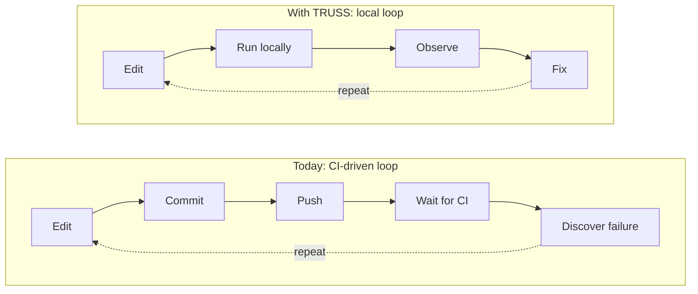
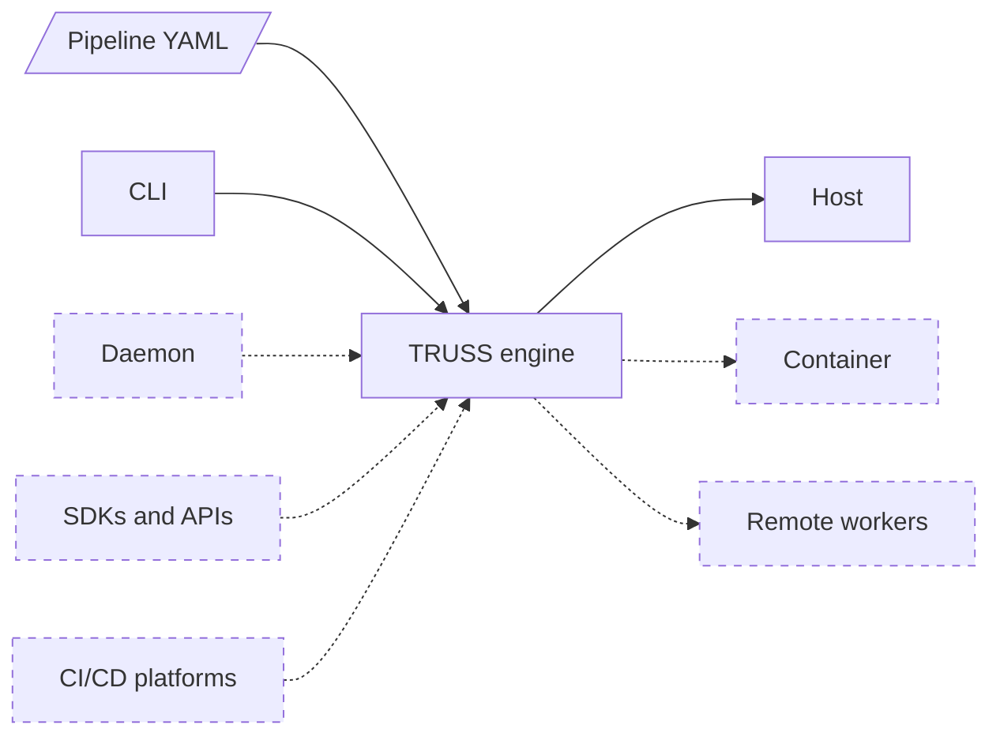
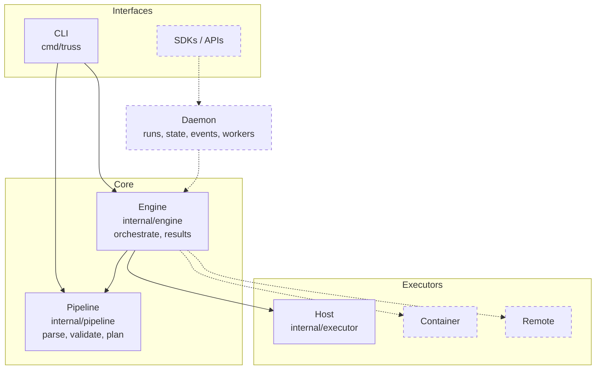
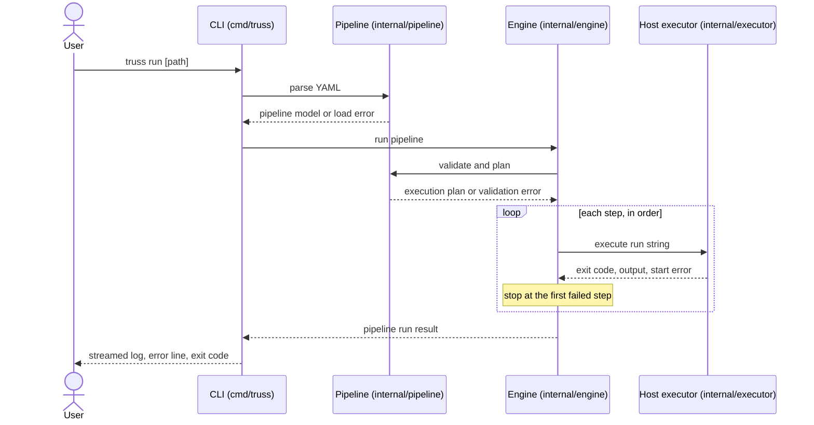
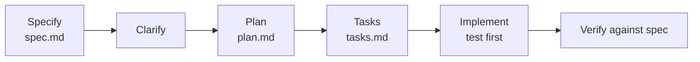

# TRUSS

**A portable pipeline execution platform. Define a pipeline once in YAML and run it the same way on your machine, in CI, and anywhere else.**

[](https://github.com/afri-bit/truss/actions/workflows/ci.yml)
[](go.mod)
[](LICENSE)

> **Status:** early development. The engine runs pipelines on the host today. No version has been tagged yet, and the pipeline schema and CLI output may still change before the first release.

## Contents

- [Why TRUSS](#why-truss)
- [Vision](#vision)
- [Features](#features)
- [Getting started](#getting-started)
- [Usage](#usage)
- [Pipeline definition](#pipeline-definition)
- [Architecture](#architecture)
- [Tech stack](#tech-stack)
- [Roadmap](#roadmap)
- [Development](#development)
- [License](#license)

## Why TRUSS

Pipelines are software, but they are rarely developed like software.

- **Slow feedback.** You commit and push, then wait in a CI queue just to find out whether a single command works.
- **Locked to one platform.** A pipeline written for GitHub Actions, GitLab CI, Jenkins, or Azure Pipelines only runs there. Moving platforms means rewriting it.
- **Hard to debug.** Failures happen on a remote runner you can't step into, with an environment you can't easily reproduce.
- **Implicit behavior.** It is often unclear what runs, in what order, with which environment, and why it failed.

TRUSS treats a pipeline as an executable artifact rather than platform configuration. The same definition runs locally while you work on it and unchanged wherever it is deployed.



## Vision

TRUSS aims to be a lightweight execution layer for software pipelines. The place a pipeline runs may change; its definition and execution semantics should not.



<sub>Solid: available today. Dashed: planned.</sub>

### Design principles

- **Local first.** If a pipeline can run on a developer machine, it should. Remote CI is not required to find out whether a pipeline works.
- **Portable.** The pipeline model does not depend on any CI provider, container runtime, or orchestrator. Those integrate with TRUSS; they do not define its semantics.
- **Engine first.** Parsing, validation, planning, execution, and results form the core. The CLI, daemon, SDKs, and dashboards build on top of it.
- **Explicit over magic.** You can tell what will run, in what order, with what environment, what each step produced, and why something failed.
- **Small, but clean.** The scope starts deliberately small, with clear boundaries, strong contracts, and tests from day one.

## Features

Available today:

- YAML pipeline definitions (schema version `"1"`).
- Validation before execution. An invalid definition never starts a command.
- Sequential host execution through `/bin/sh -c` on Unix and `cmd /c` on Windows.
- Each step runs in the invoker's working directory with the invoker's environment.
- Output streamed live, step by step.
- Fail-fast behavior. The first failed step stops the run and reports its real exit code.
- Linux, macOS, and Windows support.

## Getting started

### Install

With Go 1.27.3 or newer:

```bash
go install github.com/afri-bit/truss/cmd/truss@latest
```

Prebuilt binaries for Linux, macOS, and Windows (amd64 and arm64) will be published on [GitHub Releases](https://github.com/afri-bit/truss/releases) starting with the first tagged version.

### Build from source

```bash
git clone https://github.com/afri-bit/truss.git
cd truss
go build -o bin/truss ./cmd/truss
```

### Your first pipeline

Create `truss.yaml`:

```yaml
version: "1"

pipeline:
  name: hello-world

steps:
  - id: hello
    run: echo "Hello from TRUSS"
  - id: where
    run: echo "running in $PWD"
```

Run it:

```console
$ truss run
[hello]
Hello from TRUSS
[where]
running in /home/me/project
```

## Usage

```text
truss run [<path>]
```

| Command | Behavior |
|---|---|
| `truss run` | Loads `truss.yaml` from the current directory. It does not search for other filenames. |
| `truss run <path>` | Loads the given file. Any filename is valid. |
| anything else | Prints `usage: truss run [<path>]` and exits 1 without running anything. |

### Output

Each step prints its id in brackets, followed by its stdout and stderr as the process writes them. A successful run prints nothing else.

When a step fails, later steps are skipped and one line on standard error names the pipeline, the step, and the step's exit code:

```console
$ truss run ci.yaml
[first]
first
[second]
error: fail-fast failed at second (exit 3)
```

An invalid definition is rejected before any step runs:

```console
$ truss run broken.yaml
error: missing or unsupported schema version
```

### Exit codes

| Outcome | `truss` exit code |
|---|---|
| Every step succeeded | `0` |
| A step failed, or the file is missing, unreadable, invalid YAML, or fails validation | `1` |

The `truss` exit code is not the step's exit code. The step's exit code appears in the error line.

## Pipeline definition

```yaml
version: "1"            # required, quoted string; only "1" is supported

pipeline:
  name: build-and-test  # required, non-empty

steps:                  # required, at least one step
  - id: build           # required, unique within the pipeline
    run: go build ./... # required, one command string for the host shell
  - id: test
    run: go test ./...
```

| Field | Rules |
|---|---|
| `version` | Must be the string `"1"`. A bare number such as `1` is rejected. |
| `pipeline.name` | Required and non-empty. |
| `steps` | A list with at least one step. Steps run in the order they are listed. |
| `steps[].id` | Required, non-empty, and unique. |
| `steps[].run` | Required and non-empty. The host shell interprets it, including quotes, pipes, and variable expansion. |

Every step starts a new shell, so `cd` or `export` in one step does not carry over to the next. The full contract lives in [`specs/001-host-pipeline-engine/contracts/pipeline-v1.md`](specs/001-host-pipeline-engine/contracts/pipeline-v1.md).

## Architecture

TRUSS is layered so that execution behavior lives in the engine, never in the interface used to start it.



<sub>Solid: implemented. Dashed: planned.</sub>

### How a run works



### Boundaries

| Package | Responsibility |
|---|---|
| `cmd/truss` | Arguments, file resolution, terminal output, process exit codes. No execution logic. |
| `internal/pipeline` | Pipeline model, YAML parsing, validation, and the execution plan. Never executes anything. |
| `internal/engine` | Runs a plan step by step, applies fail-fast, and returns structured results. Independent of the CLI. |
| `internal/executor` | Runs one command in the host shell and reports its exit code, output, and start errors. |

Rules the code follows:

- Parsing never executes a pipeline.
- The engine does not depend on the CLI, and the CLI contains no engine logic.
- Pipeline models stay independent of the execution backend.
- Exit codes, failures, and cancellation propagate accurately across layers. Subprocess failures are never swallowed.
- Secrets and the environment are not echoed into reports.

### Repository layout

```text
truss/
├── cmd/truss/              CLI entry point
├── internal/
│   ├── pipeline/           model, parse, validate, plan
│   ├── engine/             orchestration and results
│   └── executor/           host shell execution
├── specs/                  feature specifications, plans, contracts, tasks
├── docs/GLOSSARY.md        product vocabulary
├── .specify/               Spec Kit configuration and project constitution
├── .github/                CI and release workflows, test scripts
├── AGENTS.md               workflow guide for coding agents
└── CHANGELOG.md
```

## Tech stack

| Area | Choice |
|---|---|
| Language | Go 1.27.3 for the engine, CLI, and future daemon |
| Dependencies | Go standard library, plus `gopkg.in/yaml.v3` for YAML decoding only |
| Process execution | `os/exec` with `/bin/sh -c` (Unix) or `cmd /c` (Windows) |
| Testing | `go test` unit, contract, and integration tests with the race detector, plus end-to-end tests of the built binary |
| Quality | `gofmt`, `go vet`, golangci-lint, shellcheck, actionlint, govulncheck |
| CI/CD | GitHub Actions on Linux, macOS, and Windows; tag-driven releases |
| Process | Specification-driven development with [Spec Kit](https://github.com/github/spec-kit) |

SDKs and integrations may be written in other languages. Public contracts such as the pipeline schema and CLI behavior must not depend on Go-specific details.

## Roadmap

TRUSS grows from the engine outward. Each item below gets its own specification before it is built, so the scope and order may change.

**Execution**

- Dependency graphs between steps
- Concurrent step execution
- Cancellation
- Container execution
- Remote workers

**Platform**

- Execution events and log streaming
- Daemon for managing runs, concurrency, and execution state
- APIs and SDKs

**Ecosystem**

- CI/CD platform integrations
- Visualization and dashboards

Advanced caching, matrix builds, and cloud orchestration are out of scope for now.

## Development

TRUSS is built with specification-driven development. Behavior is specified before it is implemented, and every behavior change starts from a failing test.



- [`.specify/memory/constitution.md`](.specify/memory/constitution.md) holds the engineering principles.
- [`specs/`](specs/) holds one folder per feature: spec, plan, contracts, and tasks.
- [`AGENTS.md`](AGENTS.md) explains the workflow for coding agents.

### Checks

```bash
gofmt -l .                                   # must print nothing
go vet ./...
go test -race ./...                          # unit, contract, and integration tests
golangci-lint run ./...
go build -o bin/truss ./cmd/truss
bash .github/scripts/e2e-test.sh bin/truss   # end-to-end tests of the built binary
```

CI runs all of these on Linux, macOS, and Windows for every pull request and every push to `main`.

### Releasing

Releases are cut by pushing a semantic version tag such as `v0.1.0` or `v0.2.0-rc.1`. The release workflow refuses to publish unless:

1. The `// version: X.Y.Z` line in `go.mod` equals the tag.
2. The module path follows Go's major-version rule: no suffix for v0 and v1, `/vN` from v2 onward.
3. `CHANGELOG.md` has `## [X.Y.Z] - YYYY-MM-DD` as its latest section, with entries and the tag's date.

It then runs the full CI suite, builds binaries for every platform, and publishes a GitHub Release. The release notes combine the changelog section with notes generated by GitHub. Pre-release tags are published as pre-releases.

## License

TRUSS is released under the [MIT License](LICENSE).
