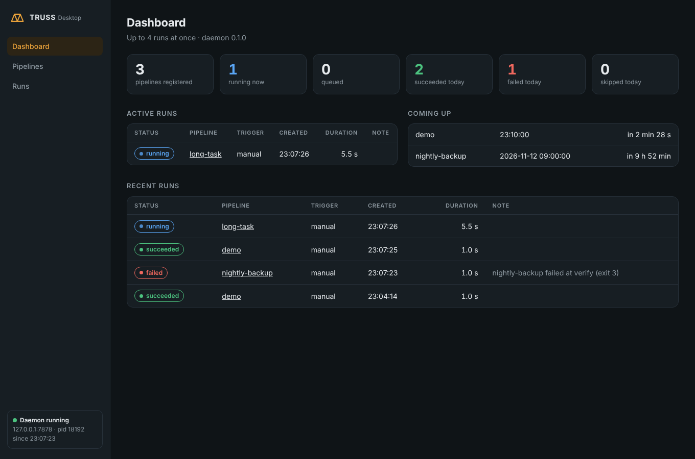
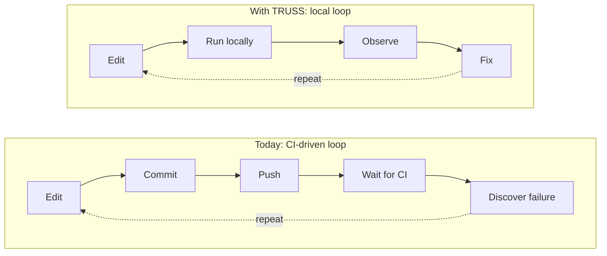
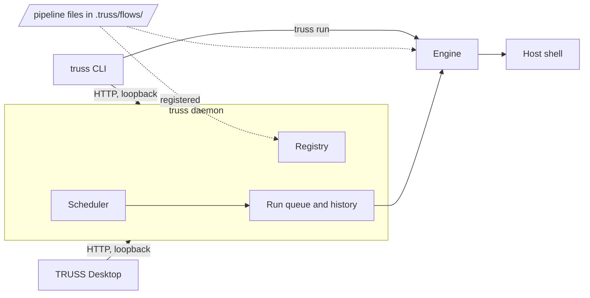

<h1 align="center">TRUSS</h1>

<p align="center">
  
</p>

<p align="center">
  <strong>Pipelines that live on your machine.</strong><br>
  Write one YAML file, run it by hand or on a schedule,<br>
  and watch it from the terminal or from TRUSS Desktop.
</p>

<p align="center">
  <a href="https://github.com/afri-bit/truss/actions/workflows/ci.yml"></a>
  <a href="go.mod"></a>
  <a href="LICENSE"></a>
</p>

<p align="center">
  <a href="#quick-start">Quick start</a> ·
  <a href="docs/pipeline-reference.md">Pipeline file</a> ·
  <a href="docs/cli.md">Commands</a> ·
  <a href="docs/daemon.md">Daemon</a> ·
  <a href="docs/desktop.md">Desktop</a> ·
  <a href="docs/architecture.md">Architecture</a>
</p>

> **Status:** [v0.1.0](docs/MILESTONE.md) is the first release. The pipeline file, the CLI and the daemon API may still change before 1.0.

<p align="center">
  
</p>

## Contents

- [Why TRUSS](#why-truss)
- [What you get](#what-you-get)
- [Quick start](#quick-start)
- [Three ways to use TRUSS](#three-ways-to-use-truss)
- [A pipeline file](#a-pipeline-file)
- [Commands](#commands)
- [How it fits together](#how-it-fits-together)
- [Documentation](#documentation)
- [Roadmap](#roadmap)
- [Contributing](#contributing)
- [License](#license)

## Why TRUSS

Pipelines are software, but they are rarely developed like software.

- **Slow feedback.** You commit and push, then wait in a CI queue just to find out whether a single command works.
- **Locked to one platform.** A pipeline written for GitHub Actions, GitLab CI, Jenkins, or Azure Pipelines only runs there. Moving platforms means rewriting it.
- **Hard to debug.** Failures happen on a remote runner you can't step into, with an environment you can't easily reproduce.
- **Implicit behavior.** It is often unclear what runs, in what order, with which environment, and why it failed.

TRUSS treats a pipeline as an executable artifact rather than platform configuration. The same definition runs locally while you work on it and unchanged wherever it is deployed.



## What you get

- **Local first.** `truss run` executes a pipeline right where you are. No server, no account, no push.
- **Jobs and dependencies.** Group steps into jobs, let jobs wait for each other, run independent work in parallel.
- **A daemon, like Docker's.** `truss daemon start` gives you a queue, a history and one API for every client.
- **Cron that understands laptops.** Schedules live in the pipeline file. A job planned for 09:00 does not fire at 11:00 because you opened the lid late, unless you ask for a catch-up run.
- **Register what you want watched.** Your files stay in your projects; the daemon only remembers where they are and re-reads them when they change.
- **Concurrency you control.** Steps per run, runs per machine, and whether a pipeline may overlap itself.
- **TRUSS Desktop.** A dashboard, pipeline controls, step graphs and live logs, built into the same binary.
- **One small binary.** Go standard library plus a YAML parser. Linux, macOS and Windows.

## Quick start

### Install

With Go 1.27.3 or newer:

```bash
go install github.com/afri-bit/truss/cmd/truss@latest
```

Or build from source:

```bash
git clone https://github.com/afri-bit/truss.git
cd truss
go build -o bin/truss ./cmd/truss
```

Or download a prebuilt binary for Linux, macOS or Windows (amd64 and arm64) from [GitHub Releases](https://github.com/afri-bit/truss/releases/latest). Each release lists SHA-256 checksums.

### 1. Run a pipeline by hand

A project is a folder with a `truss.yaml` file that names it. Pipelines are files in
`.truss/flows/`. Create the project file:

```yaml
# truss.yaml
version: "1"

project:
  name: hello
```

Then add a pipeline, `.truss/flows/hello.yaml`:

```yaml
# .truss/flows/hello.yaml
version: "1"

steps:
  - id: greet
    run: echo "Hello from TRUSS"
```

```console
$ truss run hello
2026-11-12 09:00:00 ==== Setup: the environment the steps run in ====
2026-11-12 09:00:00 setup environment ready
2026-11-12 09:00:00 setup os linux
2026-11-12 09:00:00 setup arch amd64
2026-11-12 09:00:00 setup shell /bin/sh
2026-11-12 09:00:00 setup directory /home/me/project
2026-11-12 09:00:00 ==== Step greet ====
2026-11-12 09:00:00 step greet started
2026-11-12 09:00:00 step greet | Hello from TRUSS
2026-11-12 09:00:00 step greet finished duration 0.003s exit 0
2026-11-12 09:00:00 ==== Summary ====
2026-11-12 09:00:00 summary succeeded steps 1 duration 0.005s
```

Lines that start with `====` are headings: they open the setup, each step and the summary. What
a step prints always carries `step <id> |`, so TRUSS's own lines never look like your command's.

### 2. Let the daemon run it

```console
$ truss daemon start
daemon started (pid 4242, 127.0.0.1:7878)

$ truss register hello
registered hello (/home/me/project/.truss/flows/hello.yaml)

$ truss trigger hello --follow
...
2026-11-12 09:01:10 summary succeeded steps 1 duration 0.005s

$ truss runs
RUN                     PIPELINE  STATUS     TRIGGER  CREATED              DURATION  NOTE
20261112-090110-a3f9c1  hello     succeeded  manual   2026-11-12 09:01:10  0s
```

The daemon does not start by itself after a reboot. To have your schedules keep working, run
`truss daemon install` once; it starts the daemon at every login and needs no admin rights
(`truss daemon uninstall` takes it back). Details in [the daemon docs](docs/daemon.md#starting-at-login).

### 3. Put it on a schedule

Add a trigger to the pipeline file and save. The daemon picks the change up by itself.

```yaml
# .truss/flows/hello.yaml
version: "1"

on:
  schedule:
    - cron: "0 9 * * 1-5"   # weekdays at 09:00

steps:
  - id: greet
    run: echo "Hello from TRUSS"
```

```console
$ truss pipelines
NAME   STATE  NEXT RUN             LAST RUN                       FILE
hello  ready  2026-11-13 09:00:00  succeeded 2026-11-12 09:01:10  /home/me/project/.truss/flows/hello.yaml
```

### 4. Open TRUSS Desktop

```console
$ truss desktop
```

## Three ways to use TRUSS

| | You start | You use | Tracked by the daemon? |
|---|---|---|---|
| **1. Alone** | nothing | `truss run`, `truss validate` | No. The log is `.truss/state/<name>/run.log` in the project. Add `--track` (needs the daemon) to also record the run. |
| **2. With the daemon** | `truss daemon start` | the CLI: `register`, `trigger`, `runs`, `logs`, `cancel`, ... | Yes: schedules, queue, history. |
| **3. With the daemon and Desktop** | `truss daemon start`, then `truss desktop` | the same runs, seen and controlled in the browser | Yes, same state as path 2. |

The daemon is the server, like Jenkins or Docker's engine. It is always started on its own
and stays in the background. Desktop and the CLI are clients: without a daemon Desktop shows
nothing, and neither client starts or stops it.

Path 1 is deliberately separate. `truss run` executes in your shell with your environment, needs
no server, and behaves the same in CI. If you want a run to appear in the history and in Desktop,
either register the file and use `truss trigger` (the daemon runs it, with the daemon's environment),
or keep running in your shell and add `--track`: `truss run --track` still uses your environment and
only reports to the daemon, which shows it as a `local` run.

Pipelines are written in files, with your editor. Desktop watches and controls them; it does not edit them.

## A pipeline file

Each file in `.truss/flows/` is one pipeline. A project can hold as many as you need:
`build.yaml`, `test.yaml`, `nightly.yml`. Run one by its file name without the extension:
`truss run nightly`.

```yaml
# .truss/flows/nightly.yaml
version: "1"

pipeline:
  concurrency: 3            # steps at once
  overlap: skip             # never run on top of itself

on:
  schedule:
    - cron: "30 1 * * *"
      missed: run           # catch up once if the machine was off

env:
  STAGE: nightly

steps:
  - id: vet
    run: go vet ./...
  - id: unit
    run: go test ./...
    timeout: 10m
  - id: build
    needs: [vet, unit]      # waits for both
    run: go build -o dist/app ./cmd/app
  - id: publish
    needs: [build]
    run: ./scripts/publish.sh
    env:
      CHANNEL: nightly
```

`vet` and `unit` run side by side; `build` starts when both succeeded. The first failed step
fails the run and stops the rest, unless you opt into retries, `continue-on-error` or `if`
conditions. A file has `steps` or `jobs`, never both. Every field is described in the
[pipeline file reference](docs/pipeline-reference.md), and the layout of a project is in
[Project layout](docs/pipeline-reference.md#project-layout).

## Commands

| | Command | |
|---|---|---|
| **Run here** | `truss run <name\|path> [--track]` | Run a pipeline now; with no argument it is an error that lists the pipelines. `--track` also reports it to the daemon |
| **Debug** | `truss flows show <name\|path> <step>` | One step: its command, its neighbours and a table of the environment it can use (secrets as `set` or `missing`) |
| | `truss run <name\|path> --step <id>` \| `--from <id>` | Run one step, or a step and what needs it (`--with-needs`, `--env NAME=VALUE`); the saved run log stays |
| | `truss validate [<name\|path>]` | Check a pipeline and show its steps; with no argument, check the project and every pipeline |
| **Secrets** | `truss secret set <name>` \| `list` \| `remove <name>` | Store credentials for `secrets:` in a file (value from stdin) |
| **Daemon** | `truss daemon start` \| `stop` \| `status` | Manage the background service |
| | `truss daemon install` \| `uninstall` | Start the daemon at login, or stop doing so |
| | `truss desktop` | Open TRUSS Desktop |
| **Pipelines** | `truss register <name> [--name <name>]` | Make a pipeline known to the daemon |
| | `truss register <path> [--name <name>]` | Same, for a pipeline file by path |
| | `truss register --all` | Register every pipeline in the project |
| | `truss unregister <name>` | Forget it; the file and history stay |
| | `truss pipelines` | List registrations, next and last run |
| | `truss pause <name>` \| `resume <name>` | Stop or restart its schedules |
| | `truss cache clear <name>` | Empty a pipeline's cache folder (no daemon needed) |
| **Runs** | `truss trigger <name> [--follow]` | Start a run now |
| | `truss runs [<name>]` | List runs, newest first |
| | `truss logs <run-id> [--follow]` | Show a run log |
| | `truss cancel <run-id>` | End a queued or running run |

Details and exit codes: [command line reference](docs/cli.md).

## How it fits together



`truss run` and the daemon drive the same engine, so a pipeline behaves the same either way.
The engine knows nothing about the daemon, and the daemon knows nothing about its clients.
The full map is in [docs/architecture.md](docs/architecture.md).

## Documentation

| Read this | When you want to |
|---|---|
| [Getting started](docs/getting-started.md) | Go from install to a scheduled pipeline in five minutes |
| [Pipeline file reference](docs/pipeline-reference.md) | Know every field, cron syntax, and recipes |
| [Using the command line](docs/cli-guide.md) | Tour the commands: status, dashboard, flows, runs, scripting with `--json` |
| [Command line reference](docs/cli.md) | Look up a command or an exit code |
| [The daemon](docs/daemon.md) | Understand registration, schedules, missed runs, concurrency, the HTTP API |
| [TRUSS Desktop](docs/desktop.md) | See what the UI offers |
| [Architecture](docs/architecture.md) | Find your way around the code |
| [Glossary](docs/GLOSSARY.md) | Check what a word means here |
| [Milestone](docs/MILESTONE.md) | See what v0.1.0 includes and what waits |
| [Decisions](docs/decisions/) | Learn why something is the way it is |
| [Specifications](specs/) | Read the requirements behind each feature |

The same docs are also a website with search and a home page, built from `docs/` by [`site/`](site/)
(`cd site && npm ci && npm run dev`).

## Roadmap

After v0.1.0, roughly in this order. Scope and order may change.

- **Desktop:** a packaged window with tray icon, notifications and start at login
- **Pipelines:** matrix builds, artifacts
- **Triggers:** file changes and webhooks
- **Execution:** containers, then remote workers
- **Ecosystem:** SDKs and CI-provider bridges, so the same file runs in CI

## Contributing

[CONTRIBUTING.md](CONTRIBUTING.md) has the rules for changing TRUSS: build and checks, specs and tests, branches and commits, pull requests and releases.

## License

TRUSS is released under the [Apache License 2.0](LICENSE). See [NOTICE](NOTICE).
