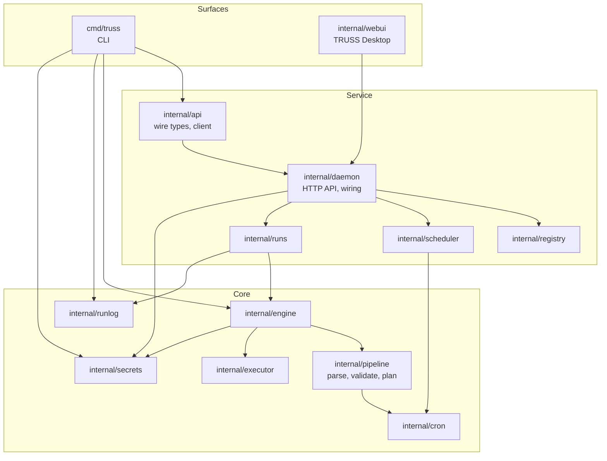
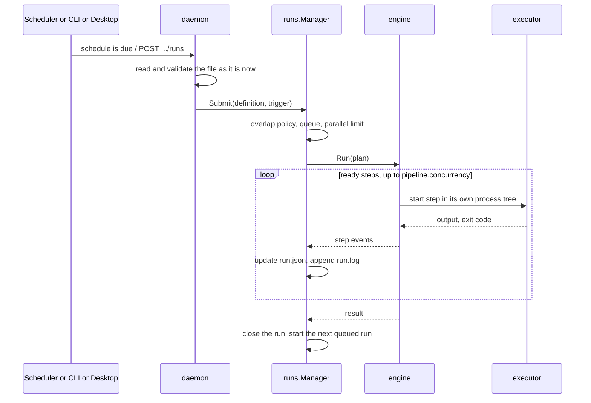

# Architecture

TRUSS is one Go module and one binary. This page is the map: which package does what, who may
call whom, and how a run travels through them.

## The layers



The rule that holds it together: **arrows only point down.** The core knows nothing about the
daemon, and the daemon knows nothing about the CLI or the UI. `truss run` and the daemon are
two callers of the same engine, so a pipeline behaves the same in both.

## Packages

| Package | Job | Must not |
|---|---|---|
| `cmd/truss` | Arguments, terminal output, exit codes. Starts and stops the daemon process. | Hold execution or scheduling logic. |
| `internal/pipeline` | The pipeline model: parse YAML, validate, and plan (flatten jobs into a step graph). | Run anything or print. |
| `internal/cron` | Parse cron expressions and compute the next matching time. | Know what a match starts. |
| `internal/engine` | Run a plan: start ready steps, respect concurrency, stop on failure, report events. | Print, read flags, or know about the daemon. |
| `internal/executor` | Run one command in the host shell inside a stoppable process tree. | Decide ordering. |
| `internal/secrets` | Keep named secret values in a private file; remove values from output streams. | Know pipelines or the engine. |
| `internal/runlog` | Format and write the run log. | Execute steps. |
| `internal/home` | Locate the TRUSS home directory and read and write its JSON files safely. | Hold state. |
| `internal/registry` | Remember registered pipeline files by name. | Read pipeline content. |
| `internal/scheduler` | Decide, for a given time, which schedules fire, catch up, or were missed. | Own a timer or start runs. |
| `internal/runs` | Queue, execute and remember runs; enforce the parallel limit and overlap policy. | Know about HTTP or schedules. |
| `internal/api` | The daemon's JSON types and a Go client for them. | Contain server logic. |
| `internal/daemon` | Wire registry, scheduler and runs together; serve the HTTP API; watch files. | Reimplement what those packages do. |
| `internal/webui` | TRUSS Desktop's static files, embedded in the binary. | Contain Go logic beyond serving files. |

## A run through the daemon



`truss run` is the lower half only: the CLI calls the engine directly and prints the events. With
`--track` it also reports the run to the daemon's API (steps, log, outcome), which records it as a
`local` run; the daemon does not execute it ([ADR 0007](decisions/0007-tracked-local-runs.md)).

## Design choices worth knowing

- **Jobs are flattened.** The planner turns jobs into steps named `job/step` with ordinary
  `needs`. The engine only ever sees one graph of steps, so jobs cost it nothing.
- **The scheduler is a pure function of time.** `Tick(now)` returns decisions. The daemon owns
  the ticker. Tests move a fake clock instead of sleeping.
- **Missed is a first-class outcome.** A schedule that fires late is not silently run or
  silently dropped; it becomes a recorded `skipped` run or an explicit `catch-up` run.
- **Files are the source of truth.** The registry stores a path, never a copy. The daemon
  re-reads a file when its modification time or size changes and before every run.
- **State is plain files.** JSON and text under `~/.truss`, written atomically. No database.
- **One API for every client.** The CLI and TRUSS Desktop have no private channel.
- **Standard library first.** The only third-party module is `gopkg.in/yaml.v3`.

Decisions with their reasons are in [`docs/decisions/`](decisions/).

## Testing

| Level | Where | What it proves |
|---|---|---|
| Unit | next to each package | Parsing, validation, cron math, scheduler decisions, registry persistence. |
| Integration | `internal/engine`, `internal/runs`, `internal/daemon` | Real processes, real HTTP on a free port, a fake clock for schedules. |
| CLI | `cmd/truss` | Commands, output and exit codes against an in-process daemon. |
| End to end | `.github/scripts/e2e-test.sh` | The built binary, including a real background daemon. |

```bash
gofmt -l . && go vet ./... && go test -race ./...
go build -o bin/truss ./cmd/truss && bash .github/scripts/e2e-test.sh bin/truss
```
