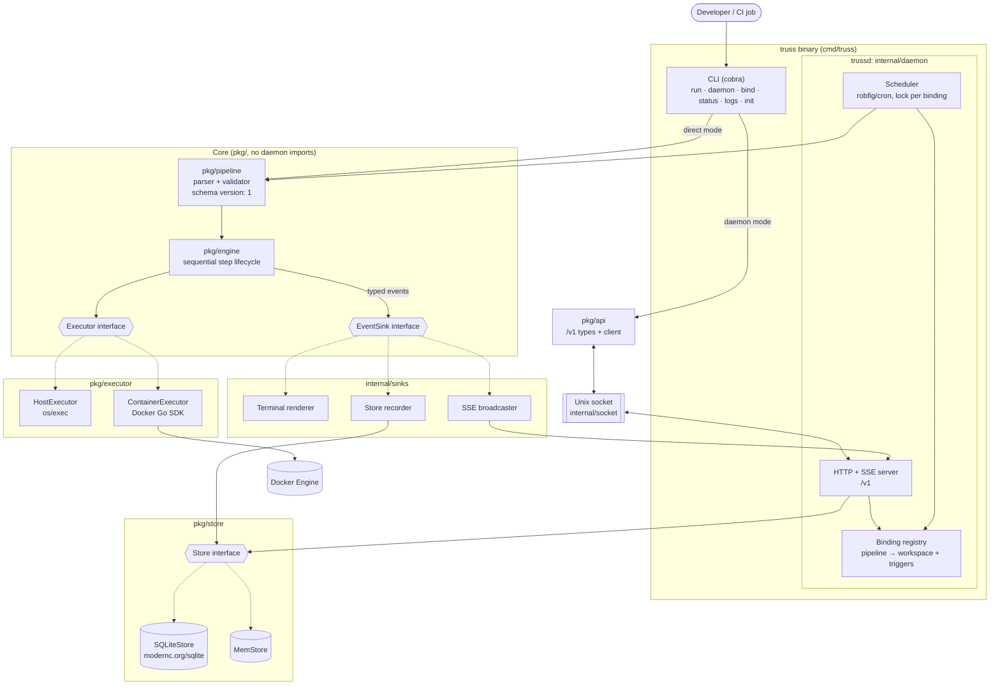
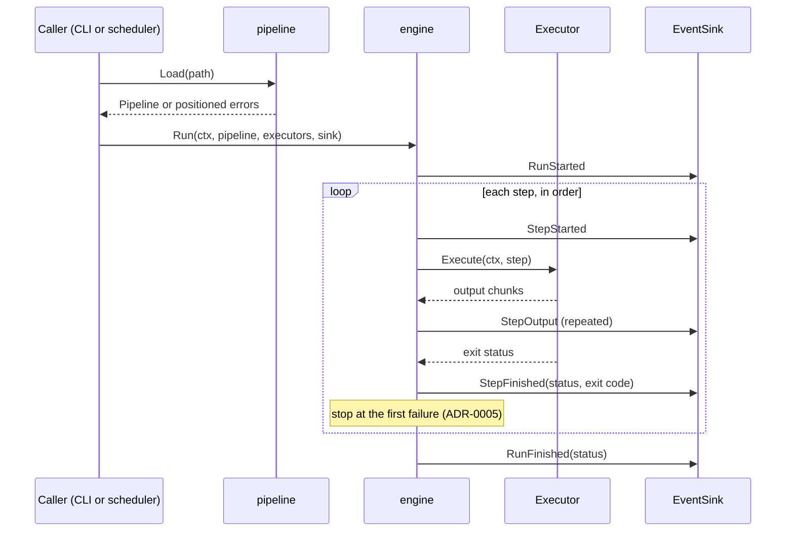
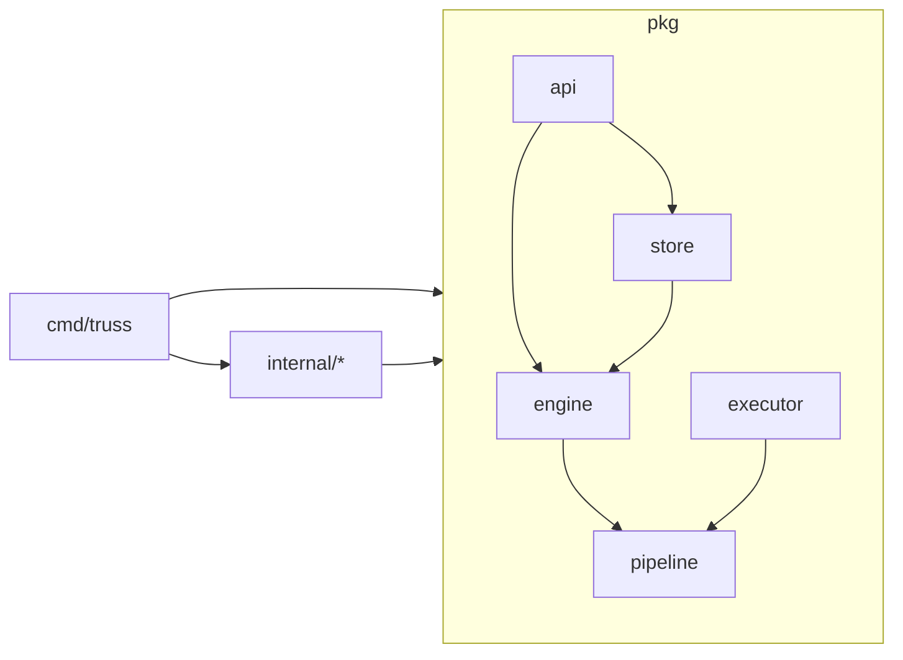

# Architecture

This document describes how TRUSS is put together: its components, the
package layout, the import rules that keep the core portable, and the public
contracts. Decisions and their rationale are recorded in the
[ADRs](adr/README.md). The rules here are normative through the
[constitution](../.specify/memory/constitution.md) ("Architecture
Constraints").

> Status: v0.1.0 target architecture. Packages currently contain only their
> documentation. Each one is filled in by an approved spec.

## Components

### Run modes

| | Direct mode | Daemon mode |
|---|---|---|
| Started by | `truss run <file>` | cron or manual trigger on a binding |
| Process | In the CLI process | In `trussd` (`truss daemon`) |
| Output | Terminal renderer on stdout | Events persisted, streamed over SSE (`truss logs`) |
| History | `MemStore` (discarded on exit) | `SQLiteStore` |
| Workspace | Current directory or flag | Explicit, from the binding |

Both modes use the same parser, engine, executors, and event types. Only
the composition in `cmd/truss` and `internal/daemon` differs.

### Run lifecycle

## Package Layout

| Package | Responsibility | May import (TRUSS) |
|---------|----------------|--------------------|
| `cmd/truss` | Composition root: flags, wiring, exit codes, printing | everything |
| `pkg/pipeline` | Schema types, YAML parsing, validation, positioned errors | nothing |
| `pkg/engine` | Step lifecycle, typed events, `Executor` and `EventSink` interfaces | `pkg/pipeline` |
| `pkg/executor` | `HostExecutor`, `ContainerExecutor` | `pkg/pipeline` |
| `pkg/store` | `Store` contract and records; `sqlite` and `mem` sub-packages | `pkg/pipeline`, `pkg/engine` (event types) |
| `pkg/api` | `/v1` request, response, and event payloads; client | `pkg/store`, `pkg/engine` (event types), `pkg/pipeline` |
| `internal/daemon` | Scheduler, binding registry, HTTP + SSE server | `pkg/*`, `internal/socket`, `internal/sinks` |
| `internal/socket` | Socket path, creation, permissions, dialing | standard library |
| `internal/sinks` | Terminal renderer, store recorder, SSE broadcaster | `pkg/*` |
| `web/` | Reserved for the v0.3 web UI | — |

Exact interfaces and type signatures are defined in each feature's
`plan.md`, not here.

## Import Rules

Dependencies point inward:
`cmd → internal → pkg/{api, store} → pkg/{engine, executor} → pkg/pipeline`.

1. `pkg/engine` imports nothing from `internal/`, `pkg/api`, or `pkg/store`,
   and no Docker, SQLite, or `net/http` packages.
2. `pkg/pipeline` imports no other TRUSS package and never `os/exec`.
3. `pkg/executor` does not import the engine, store, or API.
4. Nothing under `pkg/` imports `internal/` or `cmd/`.
5. Library packages never print or exit. `fmt.Print*`, `os.Stdout`,
   `os.Stderr`, and `os.Exit` are reserved for `cmd/`.
6. Logging uses an injected `*slog.Logger`, never the `log` package or
   global loggers.

Rules 1–5 are enforced by `depguard` and `forbidigo` in
[`.golangci.yml`](../.golangci.yml); `make lint` fails on violations.
Wiring flows the other way: `cmd/truss` constructs executors, stores, and
sinks, and passes them to the engine and daemon as interfaces.

## Typed Events

The engine reports progress only as typed event values (run started, step
started, step output, step finished, run finished) sent to an `EventSink`
([ADR-0004](adr/0004-typed-engine-events.md)). It never produces
human-readable strings. Each event carries the run ID, step ID, timestamp,
and status data such as the exit code. Sinks decide presentation:

- the **terminal renderer** formats events for direct mode;
- the **store recorder** persists runs, steps, and results;
- the **SSE broadcaster** serializes events for `/v1` subscribers.

## Public Contracts

Three interfaces are public and versioned. Changing one requires an approved
spec and an ADR.

| Contract | Version marker | Defined by |
|----------|----------------|------------|
| Pipeline schema | `version: 1` in the YAML | [spec 001](../specs/001-pipeline-schema-v1/spec.md) (draft) |
| CLI surface (commands, flags, exit codes, machine-readable output) | binary SemVer | future spec |
| HTTP API over the Unix socket | `/v1` path prefix | future spec, [ADR-0003](adr/0003-unix-socket-http-sse.md) |

Go package APIs under `pkg/` are importable but are **not** a stability
promise before v1.0.0.

## Cross-Platform

Linux, macOS, and Windows are first-class platforms, and CI runs all three
on pull requests to `main`.

- Paths use `path/filepath`. Logical paths in YAML are slash-separated and
  are converted at the boundary.
- No shell is assumed. Commands are executed with an explicit argv. Any
  shell use is declared by the pipeline and specified per OS.
- Input may contain CRLF line endings or a UTF-8 BOM. The repository
  normalizes to LF (`.gitattributes`).
- The Unix socket works on Windows 10 1803+ and Server 2019+ (AF_UNIX).
- Release builds use `CGO_ENABLED=0` (ADR-0001, ADR-0002).

## Out of Scope for v0.1.0

DAG and parallel steps (ADR-0005), secrets backend, caching, artifacts,
provider adapters (GitHub Actions or Jenkins import), and the web UI
(planned for v0.3; `web/` is reserved).
