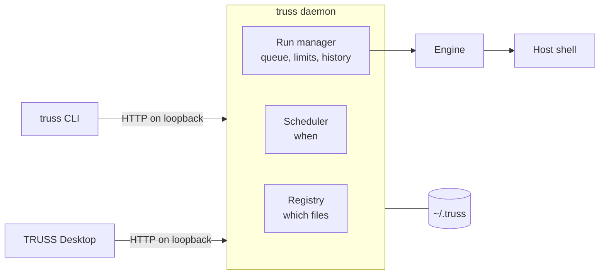

# The daemon

`truss run` is enough to run a flow by hand. The daemon adds everything that needs someone
to stay awake: schedules, a queue, a history, and one place where the CLI and
[TRUSS Desktop](desktop.md) see the same state. It works like Docker's: a background service
on your machine, and a CLI that talks to it.



The daemon is the server and is started separately, like Jenkins or Docker's engine. The CLI
and [TRUSS Desktop](desktop.md) are clients. Desktop cannot start or stop the daemon, and
without one it has nothing to show. `truss run` does not use the daemon at all, so its runs are
not part of the daemon's history; to track a run, register the file and `truss trigger` it.

## A first session

```console
$ truss daemon start
daemon started (pid 4242, 127.0.0.1:7878)

$ truss register nightly               # registers .truss/flows/nightly.yaml
registered nightly (/home/me/project/.truss/flows/nightly.yaml)
schedule 0 9 * * 1-5: next run 2026-11-13 09:00:00

$ truss trigger nightly --follow       # do not wait for 09:00
...
$ truss runs
RUN                     FLOW      STATUS     TRIGGER  CREATED              DURATION  NOTE
20261112-101502-a3f9c1  nightly   succeeded  manual   2026-11-12 10:15:02  4.2s

$ truss desktop                        # the same, with a UI
```

## Registering flows

Your flow files live in your projects. The daemon cannot guess where, so you tell it:

- `truss register <name>` registers a flow in the project you are in, from `.truss/flows/`.
- `truss register <path>` registers any flow file.
- `truss register --all` registers every flow in the project, each under its flow name. Their schedules start firing. The daemon re-reads a registered file on every run, so a later `git pull` changes what scheduled runs execute. When every flow registered, the command prints `registered N flows (M with schedules)`. It prints no summary when a flow failed.

A registration is only a name and a path. The layout of a project is in
[Project layout](pipeline-reference.md#project-layout).

- The file stays where it is and stays the source of truth. The daemon reads it again before
  every run and notices edits within a second: change the steps, the cron line or the name, save,
  done. There is nothing to restart or register again.
- **Renaming.** A registration keeps the name it was registered under (its *registered name*) for
  good: its history, schedules and [data folder](#data-and-cache-folders) hang on it. When the file
  changes `flow.name`, the daemon shows the new name, keeps every earlier run with the flow, and
  accepts either name in every command. The API reports the registered name as `registered_name`
  while the two differ, and each run as `registered_pipeline`.
  - A new name that another registration holds or claims is not taken, and neither is a name you
    chose with `--name` (or in Desktop's name field). Registering again with `--name` set to the
    registered name keeps it.
  - A file that stops loading keeps the name it was last read with (until the daemon restarts).
  - **Scripts and schedulers should use the registered name.** A shown name can move to another flow;
    a registered name never does.
  - To change the registered name, unregister and register again (the history stays with the old
    name). A file registered again without `--name` is never registered twice.
  - On a network or synced folder a change may show later than one second, because the operating
    system reports file times late there.
- A flow in a project (`.truss/flows/` under a folder with a `truss.yaml`) runs its steps in the
  project root. Any other file runs in its own directory, as `truss run` does there. Either one
  can be changed with `flow.workdir`.
- A name that is already registered for another file is reported, with a hint to use `--name`
  for a different name.
- **Trust.** A repository is a weaker trust root than a file you picked yourself. `register --all`
  takes every flow a project holds, including files someone else committed. Use `--all` only
  in projects you trust.
- A file that becomes invalid is shown as `invalid` with the reason. It does not run until fixed.
- `truss unregister <name>` removes the registration. Nothing is deleted; old runs and the
  [data folder](#data-and-cache-folders) stay.
- The same file may be registered under several names with `--name`.

## Schedules

Schedules come from `on.schedule` in the file ([reference](pipeline-reference.md#onschedule)).
The daemon checks the clock every second.

**What happens when the machine was off.** The daemon remembers when it last looked at the
clock. When it looks again and finds that a planned time has passed by more than two minutes,
that time was *missed*: the laptop was closed, the machine was off, or the daemon was stopped.

| Schedule says | Result |
|---|---|
| `missed: skip` (default) | No run. The history gets a `skipped` entry: "planned for 09:00, missed". |
| `missed: run` | One `catch-up` run starts now, no matter how many times were missed. |

So a job planned for 09:00 does not start at 11:00 just because you opened the laptop late,
unless you asked for that.

`truss pause <name>` stops a flow's schedules. Times that pass while it is paused are not
missed runs; `resume` counts from now.

## Concurrency

Three limits work together:

| Limit | Set with | Default | Controls |
|---|---|---|---|
| Runs at once | `max_runs` in [the configuration](#configuration) | 4 | How many runs execute in parallel, across all flows. |
| Overlap | `flow.overlap` in the file | `queue` | Whether two runs of the *same* flow may overlap, wait, or the second is skipped. |
| Steps at once | `flow.concurrency` in the file | 1 | How many steps of one run execute in parallel. |

Runs that cannot start yet are `queued` and start in the order they were requested. The queue
survives a restart: stop the daemon and start it again, and the queued runs start, still in
order. A queued run whose flow was unregistered or no longer loads in the meantime is closed
as `failed` with the reason.

## Configuration

The daemon reads `config.yaml` in the TRUSS home (`~/.truss/config.yaml` unless `TRUSS_HOME`
says otherwise) each time it starts. The file is optional; every setting has a default.

```yaml
# ~/.truss/config.yaml
address: 127.0.0.1:7878   # where it listens; loopback only
max_runs: 4               # runs that execute at the same time
history: 200              # finished runs kept, with their logs
```

| Setting | Default | Environment variable | Flag of `truss daemon start` |
|---|---|---|---|
| `address` | `127.0.0.1:7878` | `TRUSS_DAEMON_ADDRESS` | `--address` |
| `max_runs` | `4` | `TRUSS_DAEMON_MAX_RUNS` | `--max-runs` |
| `history` | `200` | `TRUSS_DAEMON_HISTORY` | `--history` |

A flag wins over the environment variable, which wins over the file, which wins over the
default. A setting the daemon does not know, or a value it cannot use, stops it from starting with
an error that names the setting. Changes apply when the daemon starts again:
`truss daemon stop`, then `truss daemon start`.

`truss daemon config` shows what the daemon would use and where each value comes from:

```console
$ truss daemon config
file  /home/me/.truss/config.yaml

SETTING   VALUE           SOURCE
address   127.0.0.1:7878  default
max_runs  2               config.yaml
history   200             default
...
```

`--json` prints the same for a script.

## Run states

| Run | Meaning |
|---|---|
| `queued` | Waiting for a free slot or for an earlier run of the same flow. |
| `running` | Steps are executing. |
| `succeeded` | No step failed the run. A step with `continue-on-error` can fail and the run still succeeds. |
| `failed` | A step failed; the note names it. |
| `cancelled` | You cancelled it, or the daemon stopped while it was running. |
| `skipped` | Requested but never started: a missed schedule, or `overlap: skip`. |

The trigger says why a run exists: `manual`, `schedule`, `catch-up`, or `local` (started in your
shell with `truss run --track`, only recorded by the daemon).

Steps are `pending`, `running`, `succeeded`, `failed`, `stopped` (ended because another step
failed), `cancelled`, or `skipped` (never started: the run ended first, an `if` condition was false, or a step it
needs did not succeed).

A step also carries, only where they apply: `attempts` (the number of the current or last
attempt, once a step was run again after a failure), `continued_on_error` (a failed step whose
`continue-on-error` let the run go on) and `reason` (why a step was skipped). While a step waits
to retry it is `running` and keeps the exit code of its last attempt.

## What runs see

Steps start from the environment the daemon was started with, plus the file's `env`, plus
`TRUSS_RUN_ID`, `TRUSS_PIPELINE`, `TRUSS_TRIGGER`, `TRUSS_DATA_DIR` and `TRUSS_CACHE_DIR`.
If a flow needs a variable from your
shell profile, start the daemon from a shell that has it, or set it in the file. A daemon
[started at login](#starting-at-login) has the login environment instead of a shell's.

## Data and cache folders

The daemon creates `~/.truss/pipelines/<name>/` and its `cache/` folder before a run starts, and
gives their paths to every step as `TRUSS_DATA_DIR` and `TRUSS_CACHE_DIR`. Nothing in them is
ever deleted by TRUSS: not when a run ends, not when you unregister the flow. Registering
the same name again finds the old contents.

To empty a cache run `truss cache clear <name>`. It needs no daemon and works for a name that
is no longer registered. Do it while no run of that flow is active. To remove all of a
flow's data, delete `~/.truss/pipelines/<name>` yourself; nothing else refers to it.
`truss run` keeps its folders in `.truss/state/<name>/data` of the project; delete that folder
to clear them. Those folders are ignored by git (see [Project layout](pipeline-reference.md#state-folders)).

## Limits that keep the disk safe

- A run's log keeps at most 64 MiB. After that it says so and keeps no more; the run goes on, and
  `truss runs show` has its result.
- The daemon's own log is set aside as `daemon.log.1` when it is over 10 MiB at a start.
- `history` in [the configuration](#configuration) bounds how many finished runs are kept.

## Where state lives

Everything is under the TRUSS home, `~/.truss` unless `TRUSS_HOME` says otherwise. The
directory is private to your user.

| Path | Holds |
|---|---|
| `daemon.json` | Address, process id and access token of the running daemon. Removed on stop. |
| `registry.json` | Registered flows. |
| `secrets.json` | Stored secrets, plain text, `0600` (see [`truss secret`](cli.md#secrets)). Read at the start of each run that declares secrets. |
| `clock.json` | When the scheduler last looked at the clock. |
| `runs/<run-id>/run.json` | One run: status, times, steps. |
| `runs/<run-id>/run.log` | Its run log, the same format `truss run` prints. |
| `pipelines/<name>/` | The flow's data folder, `TRUSS_DATA_DIR`. |
| `pipelines/<name>/cache/` | Its cache folder, `TRUSS_CACHE_DIR`. |
| `daemon.log` | The daemon's own log when started with `daemon start`. |

Runs of `truss run` do not use this folder. They write into the project, in
`.truss/state/<name>/`.

The newest 200 runs are kept. A run that was *running* when the daemon died is closed as
`failed` on the next start. Runs that were only *queued* are kept and start again.

## Security

The daemon runs your commands, so it is careful about who may ask.

- It listens on the loopback interface only and refuses any other address.
- Every API call needs the token from `daemon.json`. A new token is created at every start. On
  Linux and macOS the file and the home directory are private to your user (`0600`, `0700`;
  `truss daemon start` refuses a home it cannot make private). **On Windows the file only has
  the access rights it inherits from its folder**: keep the home inside your user profile (the
  default) and do not point `TRUSS_HOME` at a shared folder such as `C:\` or `C:\ProgramData`.
- A registered file, a flow included, must be a regular file of at most 1 MiB. The daemon runs
  what the file says as your user, so register only files that only you can change.
- `truss desktop` opens your browser with the token in the address, which other users of the
  same machine can see in the process list while the browser starts. Treat a shared machine
  accordingly (a follow-up replaces this with a one-time ticket).
- Requests whose `Host` header does not name this machine are refused, which stops web pages
  from reaching the API through DNS tricks.

- `GET /fs` lists names only, rejects `..`, NUL bytes and (on Windows) UNC and drive-relative
  paths, and reports symbolic links at their real location.

Anyone who can read your home directory can control the daemon. That is the same trust
boundary as your shell.

## Starting at login

`truss daemon start` does not survive a reboot. One command makes your system start the daemon
at every login, with no root or administrator rights:

```console
$ truss daemon install
login start installed: /home/me/.config/systemd/user/truss.service
the daemon is running under systemd and starts at every login
to run it without a login session, once: loginctl enable-linger

$ truss daemon status
...
  at login   installed (remove with: truss daemon uninstall)

$ truss daemon uninstall
login start removed: /home/me/.config/systemd/user/truss.service
```

`install` accepts the options of `daemon run` (`--address`, `--max-runs`) and builds them into
the login item. Run it from the `truss` you want to keep: the path of that binary is what gets
recorded. It refuses a binary in a temporary directory (a `go run` build, `/tmp`, `AppData\Local\Temp`),
because the login item would stop working when the file is cleaned up. Run it again after you
move or upgrade the binary or to change the options. If a daemon is already running, a reinstall
keeps it as it is (except under systemd, which restarts it); to apply new options now, run
`truss daemon stop` and then `truss daemon install` again.

| System | What `install` creates | Restarts after a crash | Output of the daemon |
|---|---|---|---|
| Linux | systemd user unit `~/.config/systemd/user/truss.service`, enabled with `systemctl --user` | `Restart=on-failure` | the journal: `journalctl --user -u truss` |
| macOS | launchd agent `~/Library/LaunchAgents/io.github.afri-bit.truss.plist`, loaded into your `gui/<uid>` domain | `KeepAlive` on failure only | `daemon.log` in the TRUSS home |
| Windows | Task Scheduler task `truss-daemon-<user>`, at logon of your user, least privilege | up to 3 times, a minute apart | not captured; a console window stays open |

Things to know:

- A daemon you started with `truss daemon start` keeps running and is not duplicated. `install`
  then leaves the login item for the next login. `truss daemon stop` stops the daemon for now;
  on Linux and macOS the service manager does not restart it after a clean stop.
- `uninstall` removes only what `install` created, recognised by the text "Managed by truss
  daemon install" in the file or task. A unit, plist or task with that name that you wrote yourself is
  left alone and reported. It stops the daemon that the login item started, not one you started by hand.
- If `TRUSS_HOME` is set when you install, the login item uses it (Linux and macOS). A Windows
  task cannot carry it: the daemon uses the user variable of that name (`setx TRUSS_HOME ...`)
  or the default home, and `install` says so.
- Do not run `install` with `sudo` or as administrator; it refuses. The login item belongs to
  your own account.
- On Windows the task is named `truss-daemon-<your user>`, and `uninstall` ends its daemon
  without cancelling runs gracefully: run `truss daemon stop` first.
- If a unit, plist or task with the same name exists and `install` did not create it, `install`
  and `uninstall` stop with an error and leave it alone.
- On Windows the daemon runs in a console window that stays open, and its output is not saved.
  Some Windows setups only let administrators create a task that runs at logon; if `install`
  reports "access denied", TRUSS does not work around it.
- Linux runs the daemon only while you have a session. To have schedules fire without logging
  in, run `loginctl enable-linger` once.

### The environment of a login-started daemon

A daemon started at login has the login environment, **not** what your interactive shell profile
(`.bashrc`, `.zshrc`, PowerShell profile) sets up. `PATH` is shorter and variables you export in
the profile are missing. Steps inherit this environment. Prefer putting what a flow needs in
the file's `env` ([reference](pipeline-reference.md)). To give the daemon more:

- **Linux.** A drop-in survives re-running `install`:
  `systemctl --user edit truss.service`, then
  `[Service]` and `Environment="PATH=/home/me/.local/bin:/usr/local/bin:/usr/bin:/bin"`
  (one `Environment=` line per variable), then `systemctl --user restart truss.service`.
- **macOS.** Add the variables to the `EnvironmentVariables` dictionary of the plist, then reload
  it: `launchctl bootout gui/$(id -u)/io.github.afri-bit.truss`, then
  `launchctl bootstrap gui/$(id -u) ~/Library/LaunchAgents/io.github.afri-bit.truss.plist`.
  Running `truss daemon install` again regenerates the file and drops your additions.
- **Windows.** Set a user variable with `setx NAME value`; the task sees it at the next logon.

## HTTP API

The CLI and TRUSS Desktop use this API; you can too. Base path `/api/v1`, JSON bodies,
`snake_case` fields, RFC 3339 times, `Authorization: Bearer <token>` on every call. Errors are
`{"error": "..."}` with a fitting status (`400`, `401`, `403` for a foreign `Host`, `404`, `409`, `422`, `500`, `503`
while the daemon stops).

| Method and path | Does |
|---|---|
| `GET /status` | Version, address, counts, limits. |
| `GET /metrics` | CPU and memory of the machine, the daemon and each running step, plus ten minutes of host history. See [Resource figures](#resource-figures). |
| `POST /shutdown` | Stops the daemon. |
| `GET /pipelines` | Registered flows with schedules, step graph and last run. `name` is the name the file gives; `registered_name` is the name it was registered under, when that differs. Any call that takes `{name}` accepts either. |
| `POST /pipelines` | Registers `{"path": "/abs/file.yaml", "name": "optional"}`. |
| `GET /pipelines/{name}` | One flow. |
| `DELETE /pipelines/{name}` | Unregisters it. |
| `POST /pipelines/{name}/pause`, `/resume` | Stops or restarts its schedules. |
| `POST /pipelines/{name}/runs` | Requests a run; answers `202` with the run. |
| `GET /fs?path=&hidden=` | Lists one directory for the register dialog: names of folders and `.yaml`/`.yml` files, never content. Empty `path` is your home. Answers `{path, parent, roots, entries[{name, kind, link}], truncated}`. See [decision 0010](decisions/0010-desktop-file-picker-lists-names-only.md). |
| `GET /runs?pipeline=&limit=` | Runs, newest first. |
| `GET /runs/{id}` | One run with its steps. |
| `POST /runs/{id}/cancel` | Cancels it. |
| `POST /runs` | Opens a *tracked local run* (see below): `{"pipeline": "name", "steps": [{"id": "a", "needs": []}]}`. Answers `201` with the run in state `running`. |
| `POST /runs/{id}/steps` | Reports a step of a local run: `{"id", "status", "exit_code", "error"}`. |
| `POST /runs/{id}/log?offset=` | Appends text to a local run's log at its current end; answers `204` with the headers below. Max 256 KiB. |
| `POST /runs/{id}/finish` | Closes a local run: `{"status": "succeeded" \| "failed" \| "cancelled", "reason"}`. |
| `GET /runs/{id}/log?offset=` | Log text from a byte offset. `X-Truss-Log-Offset` is the next offset, `X-Truss-Run-Status` the run status; an empty body for a finished run means the log is complete. |

Each step of a run the daemon started has `pid`, the process id of its current or last attempt.

### Resource figures

The daemon samples every 2 seconds and keeps ten minutes of host history in memory; it starts no
process and writes nothing to do so. `GET /metrics` answers:

```json
{
  "supported": true, "os": "linux", "interval_seconds": 2, "sampled_at": "2026-11-13T09:00:02Z",
  "host": {"cpu_percent": 23.4, "cores": [31.0, 15.8], "memory_total_bytes": 17179869184,
           "memory_used_bytes": 9126805504, "load": [0.52, 0.58, 0.59]},
  "daemon": {"pid": 4242, "cpu_percent": 0.4, "rss_bytes": 41943040, "threads": 14, "processes": 1, "tree": false},
  "steps": [{"run_id": "20261113-090001-a1b2c3", "step_id": "test/unit", "pid": 5123,
             "cpu_percent": 12.5, "rss_bytes": 104857600, "threads": 9, "processes": 3, "tree": true}],
  "history": [{"at": "2026-11-13T09:00:00Z", "cpu_percent": 21.0, "memory_used_bytes": 9120000000}]
}
```

- CPU percentages are shares of the whole machine: 100 means every core is busy.
- **Linux** reads `/proc`. A step counts its whole process group (`tree: true`); a process that
  moves to a group of its own (`setsid`, a daemonising tool) is no longer counted.
- **Windows** uses system calls and counts the step's shell only (`tree: false`); it has no `load`
  and no `threads`.
- **macOS** uses system calls. Like Linux, a step counts its whole process group (`tree: true`)
  and the host has `load`. Memory used is what Activity Monitor calls *Memory Used*. Processes
  of another user (a step that runs `sudo`) cannot be read and are left out.
- **Other systems**: `supported` is `false` and `reason` says why. There is no `host`,
  `steps` and `history` are empty, and `daemon` has only its `pid`.
- Only steps whose attempt is running now are listed. Tracked local runs are not measured.

See [spec 015](../specs/015-resource-metrics/spec.md) and
[decisions 0012](decisions/0012-daemon-samples-resources-with-the-standard-library.md) and
[0013](decisions/0013-macos-resource-figures-through-libsystem.md).

### Tracked local runs

`truss run --track` runs a flow in your shell, as `truss run` does, and reports it through
the four `POST /runs...` endpoints above, so it appears in `truss runs` and Desktop with the
trigger `local`. The daemon never starts it and it does not use a slot of `--max-runs` or block
the overlap policy of a flow of the same name. Only a `local` run that is `running` accepts
reports; anything else answers `409`. Bodies over the limits answer `413`; a log append must start
where the log ends (`409`), and repeating one the log already holds is harmless.

Cancelling a local run (Desktop, `truss cancel`, `POST /runs/{id}/cancel`) closes its record at
once and asks the CLI to stop: it notices within a fraction of a second and ends the run's
processes like an interrupt. If the daemon stops while a local run is `running`, the run is
closed as `failed`; the process in your shell carries on and stops reporting. See
[ADR 0007](decisions/0007-tracked-local-runs.md).

```console
$ TOKEN=$(jq -r .token ~/.truss/daemon.json)
$ curl -s -H "Authorization: Bearer $TOKEN" http://127.0.0.1:7878/api/v1/status
```

The API is new and may still change before v0.1.0 is tagged.
