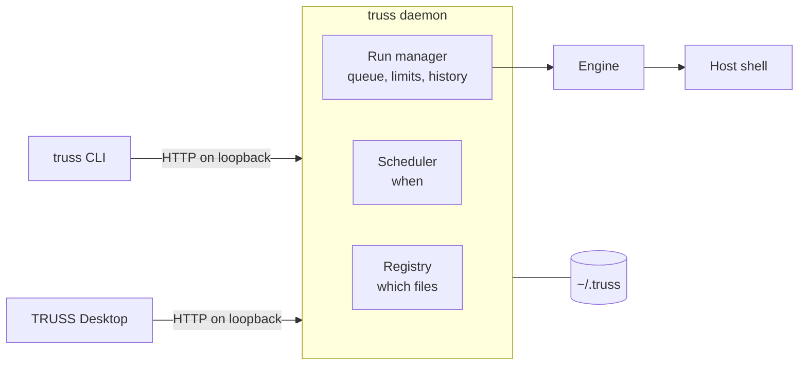

# The daemon

`truss run` is enough to run a pipeline by hand. The daemon adds everything that needs someone
to stay awake: schedules, a queue, a history, and one place where the CLI and
[TRUSS Desktop](desktop.md) see the same state. It works like Docker's: a background service
on your machine, and a CLI that talks to it.



The daemon is the server and is started separately, like Jenkins or Docker's engine. The CLI
and [TRUSS Desktop](desktop.md) are clients. Desktop cannot start or stop the daemon, and
without one it has nothing to show. `truss run` does not use the daemon at all, so its runs are
not part of the daemon's history; to track a run, register the file and `truss trigger` it.

## A first session

```console
$ truss daemon start
daemon started (pid 4242, 127.0.0.1:7878)

$ truss register                       # registers ./truss.yaml
registered nightly (/home/me/project/truss.yaml)
schedule 0 9 * * 1-5: next run 2026-11-13 09:00:00

$ truss trigger nightly --follow       # do not wait for 09:00
...
$ truss runs
RUN                     PIPELINE  STATUS     TRIGGER  CREATED              DURATION  NOTE
20261112-101502-a3f9c1  nightly   succeeded  manual   2026-11-12 10:15:02  4.2s

$ truss desktop                        # the same, with a UI
```

## Registering pipelines

Your pipeline files live in your projects. The daemon cannot guess where, so you tell it:
`truss register <path>`. A registration is only a name and a path.

- The file stays where it is and stays the source of truth. The daemon reads it again before
  every run and notices edits within a second: change the cron line, save, done.
- A run starts in the directory of the file, like `truss run` there.
- A file that becomes invalid is shown as `invalid` with the reason. It does not run until fixed.
- `truss unregister <name>` removes the registration. Nothing is deleted; old runs stay visible.
- The same file may be registered under several names with `--name`.

## Schedules

Schedules come from `on.schedule` in the file ([reference](pipeline-reference.md#onschedule)).
The daemon checks the clock every second.

**What happens when the machine was off.** The daemon remembers when it last looked at the
clock. When it looks again and finds that a planned time has passed by more than two minutes,
that time was *missed*: the laptop was closed, the machine was off, or the daemon was stopped.

| Schedule says | Result |
|---|---|
| `missed: skip` (default) | No run. The history gets a `skipped` entry: "planned for 09:00, missed". |
| `missed: run` | One `catch-up` run starts now, no matter how many times were missed. |

So a job planned for 09:00 does not start at 11:00 just because you opened the laptop late,
unless you asked for that.

`truss pause <name>` stops a pipeline's schedules. Times that pass while it is paused are not
missed runs; `resume` counts from now.

## Concurrency

Three limits work together:

| Limit | Set with | Default | Controls |
|---|---|---|---|
| Runs at once | `truss daemon start --max-runs <n>` | 4 | How many runs execute in parallel, across all pipelines. |
| Overlap | `pipeline.overlap` in the file | `queue` | Whether two runs of the *same* pipeline may overlap, wait, or the second is skipped. |
| Steps at once | `pipeline.concurrency` in the file | 1 | How many steps of one run execute in parallel. |

Runs that cannot start yet are `queued` and start in the order they were requested.

## Run states

| Run | Meaning |
|---|---|
| `queued` | Waiting for a free slot or for an earlier run of the same pipeline. |
| `running` | Steps are executing. |
| `succeeded` | No step failed the run. A step with `continue-on-error` can fail and the run still succeeds. |
| `failed` | A step failed; the note names it. |
| `cancelled` | You cancelled it, or the daemon stopped. |
| `skipped` | Requested but never started: a missed schedule, or `overlap: skip`. |

Steps are `pending`, `running`, `succeeded`, `failed`, `stopped` (ended because another step
failed), `cancelled`, or `skipped` (never started: the run ended first, an `if` condition was false, or a step it
needs did not succeed).

A step also carries, only where they apply: `attempts` (the number of the current or last
attempt, once a step was run again after a failure), `continued_on_error` (a failed step whose
`continue-on-error` let the run go on) and `reason` (why a step was skipped). While a step waits
to retry it is `running` and keeps the exit code of its last attempt.

## What runs see

Steps start from the environment the daemon was started with, plus the file's `env`, plus
`TRUSS_RUN_ID`, `TRUSS_PIPELINE` and `TRUSS_TRIGGER`. If a pipeline needs a variable from your
shell profile, start the daemon from a shell that has it, or set it in the file.

## Where state lives

Everything is under the TRUSS home, `~/.truss` unless `TRUSS_HOME` says otherwise. The
directory is private to your user.

| Path | Holds |
|---|---|
| `daemon.json` | Address, process id and access token of the running daemon. Removed on stop. |
| `registry.json` | Registered pipelines. |
| `clock.json` | When the scheduler last looked at the clock. |
| `runs/<run-id>/run.json` | One run: status, times, steps. |
| `runs/<run-id>/run.log` | Its run log, the same format `truss run` prints. |
| `daemon.log` | The daemon's own log when started with `daemon start`. |

The newest 200 runs are kept. A run that was active when the daemon died is closed as `failed`
on the next start.

## Security

The daemon runs your commands, so it is careful about who may ask.

- It listens on the loopback interface only and refuses any other address.
- Every API call needs the token from `daemon.json`, a file only your user can read. A new
  token is created at every start.
- Requests whose `Host` header does not name this machine are refused, which stops web pages
  from reaching the API through DNS tricks.

Anyone who can read your home directory can control the daemon. That is the same trust
boundary as your shell.

## Starting at login

`truss daemon start` does not survive a reboot. To have schedules work after login, let your
system start `truss daemon run`:

- **Linux (systemd user unit)**: `ExecStart=/path/to/truss daemon run`, `Restart=on-failure`,
  `WantedBy=default.target`.
- **macOS (launchd agent)**: `ProgramArguments` = `truss`, `daemon`, `run`; `RunAtLoad` = true.
- **Windows (Task Scheduler)**: a task "At log on" that runs `truss.exe daemon start`.

An installer for these is on the roadmap.

## HTTP API

The CLI and TRUSS Desktop use this API; you can too. Base path `/api/v1`, JSON bodies,
`snake_case` fields, RFC 3339 times, `Authorization: Bearer <token>` on every call. Errors are
`{"error": "..."}` with a fitting status (`400`, `401`, `404`, `409`, `422`).

| Method and path | Does |
|---|---|
| `GET /status` | Version, address, counts, limits. |
| `POST /shutdown` | Stops the daemon. |
| `GET /pipelines` | Registered pipelines with schedules, step graph and last run. |
| `POST /pipelines` | Registers `{"path": "/abs/file.yaml", "name": "optional"}`. |
| `GET /pipelines/{name}` | One pipeline. |
| `DELETE /pipelines/{name}` | Unregisters it. |
| `POST /pipelines/{name}/pause`, `/resume` | Stops or restarts its schedules. |
| `POST /pipelines/{name}/runs` | Requests a run; answers `202` with the run. |
| `GET /runs?pipeline=&limit=` | Runs, newest first. |
| `GET /runs/{id}` | One run with its steps. |
| `POST /runs/{id}/cancel` | Cancels it. |
| `GET /runs/{id}/log?offset=` | Log text from a byte offset. `X-Truss-Log-Offset` is the next offset, `X-Truss-Run-Status` the run status; an empty body for a finished run means the log is complete. |

```console
$ TOKEN=$(jq -r .token ~/.truss/daemon.json)
$ curl -s -H "Authorization: Bearer $TOKEN" http://127.0.0.1:7878/api/v1/status
```

The API is new and may still change before v0.1.0 is tagged.
