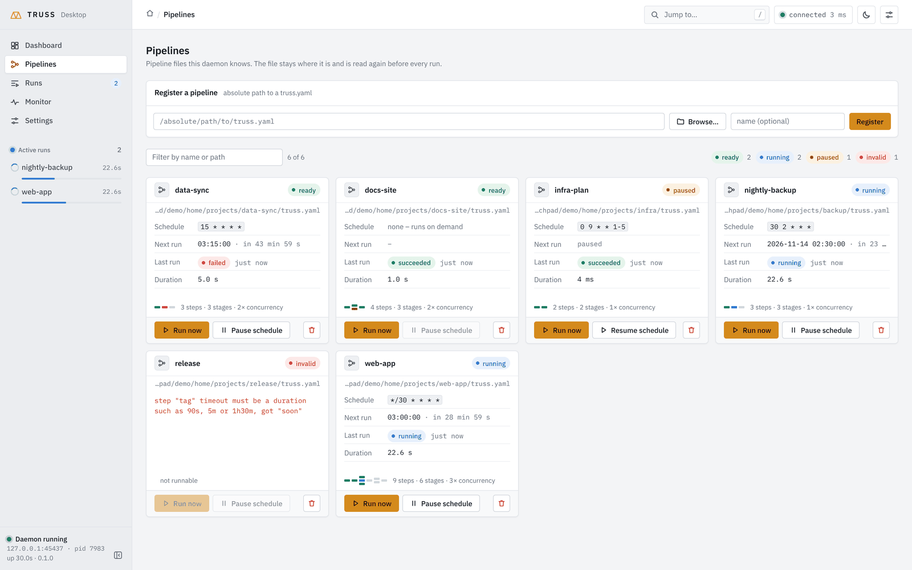
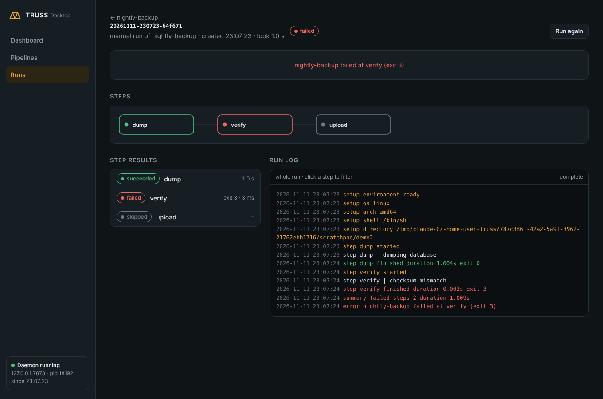
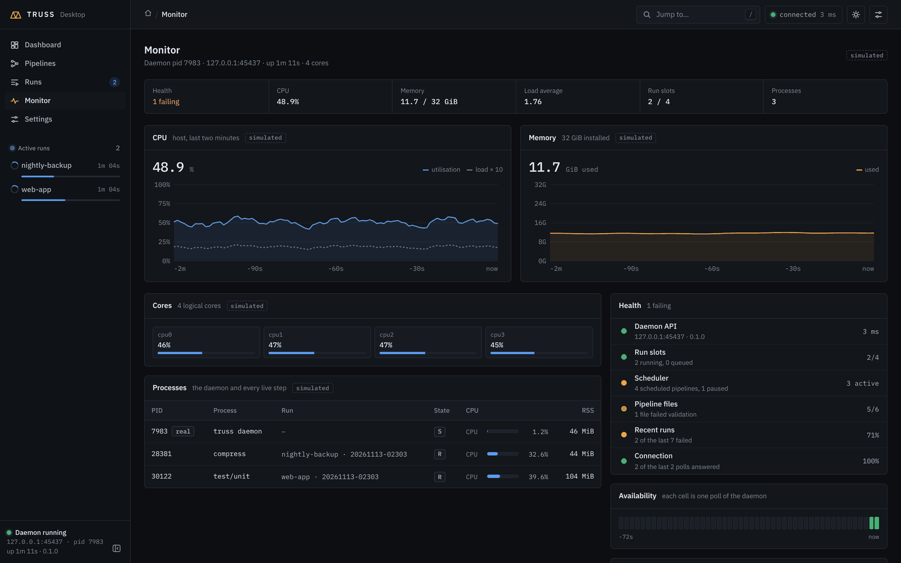

# TRUSS Desktop

TRUSS Desktop is the visual side of the daemon: what is registered, what is running, what
happened, and buttons for the things you would otherwise type.

```console
$ truss daemon start
$ truss desktop
```

The daemon must already be running: Desktop is a client and never starts or stops it. `truss desktop` opens your browser on the daemon's address. `truss desktop --no-open` prints
the address instead.


## What is on screen

One page: a sidebar on the left (pages, active runs, daemon status; collapse it with the button
at the bottom left or `[`), a header (breadcrumbs, **Jump to…** with `/`, connection and latency,
theme toggle, settings menu) and the content.

| Page | Shows | You can |
|---|---|---|
| **Dashboard** | Counters for today, active runs with progress, runs per hour, system load, health, the next scheduled runs, recent runs. | Jump to any run or pipeline. |
| **Pipelines** | Every registered file as a card: state, schedule, next and last run, shape of its step graph. | Register a file (type its path or press **Browse…**), filter, run it now, pause or resume its schedules, unregister it. |
| **Pipeline** | Its step graph colored by the last run, success rate, configuration, run history. | The same actions. |
| **Runs** | Every run the daemon started or skipped, and every run tracked from a shell, newest first. | Filter by status or text, open one. |
| **Run** | Progress, the running steps, elapsed time, the step graph with the running step highlighted, step results, the live log, resources and configuration. | Cancel the run, run it again, click a step to see only its log lines, find in the log, wrap, follow. |
| **Monitor** | Health checks, CPU and memory, cores, the daemon's process and every live step. | Open the run behind a process. |
| **Settings** | Theme, density, sidebar, motion, refresh interval, log options, daemon facts. | Change them (kept in this browser), forget the access token. |





**Resource figures** (CPU, memory, step processes) come from the daemon, which measures them on
Linux, macOS and Windows. On any other system the page says the daemon does not collect them. A run's own chart
starts when you open its page; the machine's charts show the last ten minutes. See
[spec 015](../specs/015-resource-metrics/spec.md).



Runs started with `truss run --track` appear next to the daemon's own, with a **local** badge
in the Trigger column and on the run's page. They show their steps and log live, like any run.
Cancel works (the CLI notices within a second and stops); **Run again** is not offered, because
nothing registered stands behind a local run.

The pages refresh on their own about every second and a half (change it in Settings).

## Demo mode

```console
$ truss desktop --demo
TRUSS Desktop (demo, sample data, no daemon): http://127.0.0.1:53817/#demo
Press Ctrl-C to stop.
```

`--demo` needs no daemon. It serves Desktop with sample data that the page generates itself:
ten pipelines, runs that progress while you watch, a failure, a tolerated failure, a queued run,
a paused schedule, an invalid file and a long name, plus a day of history, and sample CPU and memory figures. Run now, Cancel,
pause, resume, register and unregister work on that data. Nothing is saved and no request leaves
the page. The header says **Demo data**; **Leave demo** in the settings menu ends it. Only the server
that `--demo` starts has the sample data; a daemon's page always shows real data. Use it to
try Desktop or to review its design. The demo server is tested in-process on Linux, macOS and Windows; the
browser tests of demo mode run on Linux.

## Registering with the file picker

Browsers cannot show a file's full path, so **Browse…** asks the daemon to list folders for
you. It starts in your home directory (or the folder of the path you typed), shows folders and
`.yaml`/`.yml` files by name, and fills the path field when you pick one. Use **Show hidden**
for dot-folders. Escape closes it. The daemon never reads the files it lists.

If the daemon stops, Desktop shows **Daemon unreachable** and reconnects when it is back.

## Tests

`tests/ui/` holds browser tests (Node and Playwright) that start a real daemon and drive this
page. Run them with `go build -o bin/truss ./cmd/truss`, then `cd tests/ui && npm ci && npx
playwright install chromium && npm test`. CI runs them on Linux.

## How it is built

TRUSS Desktop is a small web application inside the `truss` binary. The daemon serves it; it
uses the same [HTTP API](daemon.md#http-api) as the CLI. There is nothing extra to install and
no build step: plain HTML, CSS and JavaScript in `internal/webui/assets/`, with the IBM Plex
fonts (SIL Open Font License) served from the binary.

The address `truss desktop` opens carries the access token after a `#`. Browsers never send
that part to a server; the page keeps it in the browser's local storage and sends it as a
header with each API call. The token changes whenever the daemon restarts, so run
`truss desktop` again after a restart.

A packaged window (its own icon, tray, start at login) is a later step and will wrap this same
application. See [decision 0004](decisions/0004-desktop-is-an-embedded-web-app.md).
