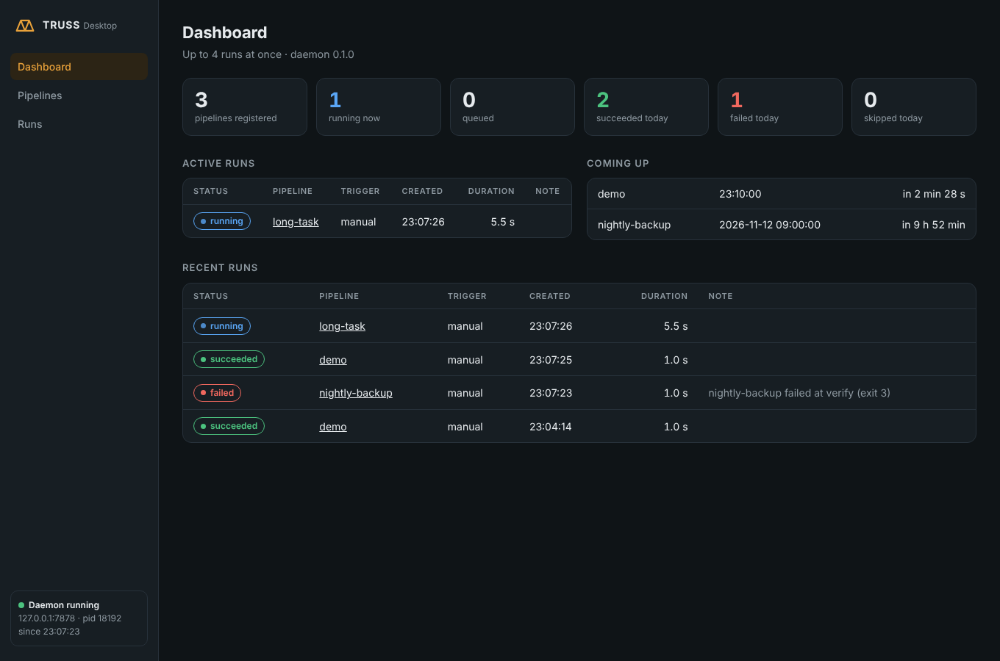

# TRUSS Desktop

TRUSS Desktop is the visual side of the daemon: what is registered, what is running, what
happened, and buttons for the things you would otherwise type.

```console
$ truss daemon start
$ truss desktop
```

The daemon must already be running: Desktop is a client and never starts or stops it. `truss desktop` opens your browser on the daemon's address. `truss desktop --no-open` prints
the address instead.



## What is on screen

| Page | Shows | You can |
|---|---|---|
| **Dashboard** | Counters for today, active runs, the next scheduled runs, recent runs. | Jump to any run or pipeline. |
| **Pipelines** | Every registered file with its state, schedules, next and last run. | Register a file, run it now, pause or resume its schedules, unregister it. |
| **Pipeline** | Its settings, its step graph colored by the last run, its run history. | The same actions. |
| **Runs** | Every run the daemon started or skipped, and every run tracked from a shell, newest first. | Open one. |
| **Run** | The step graph, each step's result and duration, and the run log, live while it runs. | Cancel the run, run it again, click a step to see only its log lines. |


Runs started with `truss run --track` appear next to the daemon's own, with a **local** badge
in the Trigger column and on the run's page. They show their steps and log live, like any run.
Cancel works (the CLI notices within a second and stops); **Run again** is not offered, because
nothing registered stands behind a local run.

The pages refresh on their own about every second and a half.

## How it is built

TRUSS Desktop is a small web application inside the `truss` binary. The daemon serves it; it
uses the same [HTTP API](daemon.md#http-api) as the CLI. There is nothing extra to install and
no build step: plain HTML, CSS and JavaScript in `internal/webui/assets/`.

The address `truss desktop` opens carries the access token after a `#`. Browsers never send
that part to a server; the page keeps it in the browser's local storage and sends it as a
header with each API call. The token changes whenever the daemon restarts, so run
`truss desktop` again after a restart.

A packaged window (its own icon, tray, start at login) is a later step and will wrap this same
application. See [decision 0004](decisions/0004-desktop-is-an-embedded-web-app.md).
