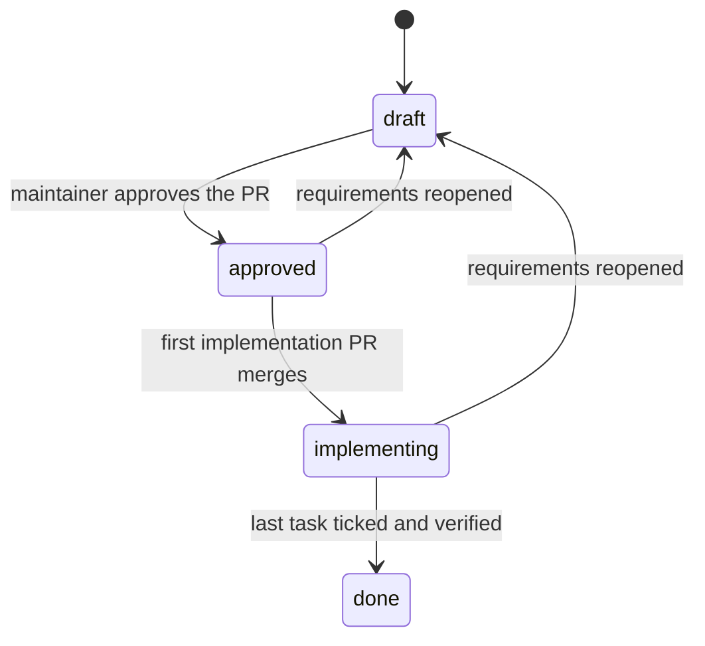

# Spec-Driven Workflow

TRUSS is built spec-first. Every behavioral change starts as a written
specification, is agreed in review, and only then is implemented, one small
task per pull request. This page is the procedure; the binding rules live in
[`.specify/memory/constitution.md`](../../.specify/memory/constitution.md)
(Principle I and Quality Gates).

## When a spec is required

| Change | Spec needed? |
|--------|--------------|
| New capability or any change to observable behavior | Yes |
| Change to a public contract (pipeline schema, CLI surface, HTTP API `/v1`) | Yes, plus an [ADR](../adr/README.md) |
| Bug fix restoring behavior an approved spec already defines | No; reference the spec and FR ID |
| Formatting, typos, dependency bumps, behavior-preserving refactors | No |

When in doubt, write the spec. A short spec is cheap; an argument in a code
review is not.

## Layout

Each feature lives in `specs/NNN-short-name/`, numbered sequentially with
three or more digits (the format the Spec Kit tooling generates):

```text
specs/
├── README.md                 # index of all specs and their status
├── _template/                # copies of the canonical templates
│   ├── spec.md
│   ├── plan.md
│   └── tasks.md
└── 001-pipeline-schema-v1/
    ├── spec.md               # WHAT and WHY
    ├── plan.md               # HOW
    └── tasks.md              # the ordered work
```

The canonical templates are `.specify/templates/{spec,plan,tasks}-template.md`,
which the Spec Kit commands use. `specs/_template/` holds byte-identical
copies for contributors who work without Spec Kit; `make spec-check` (part of
`make lint` and CI) fails if they drift.

### `spec.md`: requirements

- **Problem**: what is wrong or missing and for whom.
- **User stories**: prioritized (P1, P2, …), each independently testable,
  with Given/When/Then acceptance scenarios.
- **Functional requirements (acceptance criteria)**: numbered `FR-001`, …,
  each written in [EARS](#ears-cheat-sheet) form and testable on its own.
- **Quality, safety & compatibility**: process execution, secrets,
  cross-platform behavior, contract compatibility.
- **Success criteria**, **Non-goals**, **Assumptions**.
- Unresolved points are marked inline as `[NEEDS CLARIFICATION: …]`. A spec
  with open clarifications cannot be approved.

No implementation detail belongs here unless it is externally observable.

### `plan.md`: design

Technical context, the constitution check, the packages touched, and a
**Design** section covering approach, interfaces and type signatures, data
flow, error handling, cross-platform concerns, test strategy, public contract
impact (with ADR link), and alternatives considered.

### `tasks.md`: implementation work

An ordered checklist. Each task:

- has an ID (`T001`), optional `[P]` (parallelizable) and `[US1]` (story) tags;
- names the files it touches;
- lists the acceptance criteria it satisfies, e.g. `(FR-002, FR-004)`;
- is small enough to land as **one** pull request with its tests.

## Status lifecycle

Every `spec.md`, `plan.md`, and `tasks.md` starts with front matter:

```yaml
---
status: draft          # draft | approved | implementing | done
feature: "001-pipeline-schema-v1"
document: spec         # spec | plan | tasks
---
```



| Status | Meaning | Who changes it |
|--------|---------|----------------|
| `draft` | Under discussion. May be merged so it is visible, but nothing may be implemented against it. | Author |
| `approved` | Agreed. Implementation may start. | Author, in the PR a maintainer approves |
| `implementing` | At least one task merged. | The first implementation PR |
| `done` | All tasks ticked; behavior verified against the spec. | The last implementation PR |

Ordering rules:

1. `plan.md` cannot be `approved` before `spec.md` is.
2. `tasks.md` cannot be `approved` before `plan.md` is.
3. Reopening requirements (changing an FR) sets all three back to `draft`.
4. `specs/README.md` is updated in the same PR as any status change.

## The rule

> **No implementation PR without an approved spec.**

Every implementation PR:

- links the spec directory and lists the task IDs it completes
  (`Spec: specs/001-pipeline-schema-v1 · Tasks: T004, T005`);
- ticks those checkboxes in `tasks.md`;
- moves the status forward when it is the first (`implementing`) or last
  (`done`) task;
- contains tests that exercise the referenced FR IDs.

Reviewers reject PRs that implement behavior absent from the spec. If the
spec is wrong, fix the spec first, in its own PR.

## Step by step

1. **Specify.** Create the next `specs/NNN-short-name/` from the template
   (Claude Code: the `write-spec` skill; Cursor: `/speckit-specify`), fill
   in `spec.md`, add a row to `specs/README.md`, open a PR titled
   `docs(spec): NNN short name`.
2. **Clarify.** Resolve every `[NEEDS CLARIFICATION]` with the maintainers.
   Run the `spec-reviewer` agent to check testability and scope.
3. **Approve.** Set `status: approved` once review agrees; merge.
4. **Plan.** Write `plan.md` (Spec Kit: `/speckit-plan`). Record any
   architecturally significant decision as an ADR (`write-adr` skill).
   Approve and merge.
5. **Break down.** Write `tasks.md` (Spec Kit: `/speckit-tasks`). Approve and
   merge.
6. **Implement.** One task per PR (`implement-task` skill). Tests first.
7. **Verify.** When the last task lands, confirm every FR has a passing
   test, set all three files to `done`, and update the index.

Small specs may combine steps 1–5 in a single PR, as long as each file's
status is accurate when it merges.

## EARS cheat sheet

EARS (Easy Approach to Requirements Syntax) keeps acceptance criteria
unambiguous and testable.

| Pattern | Template | Example |
|---------|----------|---------|
| Ubiquitous | THE SYSTEM SHALL *response*. | THE SYSTEM SHALL reject pipeline files larger than 1 MiB. |
| Event-driven | WHEN *trigger*, THE SYSTEM SHALL *response*. | WHEN a step exits non-zero, THE SYSTEM SHALL mark the run failed. |
| State-driven | WHILE *state*, THE SYSTEM SHALL *response*. | WHILE a binding's run is in progress, THE SYSTEM SHALL skip new cron triggers for it. |
| Unwanted behavior | IF *condition*, THEN THE SYSTEM SHALL *response*. | IF the YAML is malformed, THEN THE SYSTEM SHALL report the line and column. |
| Optional feature | WHERE *feature*, THE SYSTEM SHALL *response*. | WHERE a step declares `executor: container`, THE SYSTEM SHALL run it in the declared image. |

Guidelines:

- One behavior per criterion; split "and" into two FRs.
- Name observable outputs: exit codes, messages, events, files.
- Avoid vague words ("fast", "user-friendly", "appropriate").
- Each FR must be checkable by an automated test.

## Architecture Decision Records

ADRs capture *why* a structural decision was made. Write one when a change:

- alters a public contract (pipeline schema, CLI surface, HTTP API `/v1`);
- adds a significant dependency or replaces one;
- changes package boundaries or import rules;
- introduces a cross-cutting pattern (concurrency model, error model, …).

ADRs live in [`docs/adr/`](../adr/README.md), use the MADR format, and are
immutable once accepted: supersede rather than edit.
